# Design Document for Harmonic — Milestone 4

**Last Updated: Milestone 4 (Sunday, November 1, 2026)**

*Milestone 3 review: Wednesday, October 21, 2026. This document describes the whole app as built at Milestone 4, for both instruments. It replaces the [M3 design document](harmonic-design-document.md) and the [M3 guitar design document](harmonic-design-document-m3-guitar.md) as the current design. Features that were dropped have been taken out of the design and are explained in the new trade-offs section (Section 7). The feature-by-feature status is in [M4 implementation of planned features](M4-implementation-of-planned-features.md), and testing is in the [M4 test plan](M4-test-plan.md). Deployed at **https://harmonic-vert.vercel.app**.*

### Changes since Milestone 3 at a glance

| Area | At M3 (Oct 21) | At M4 (Nov 1) |
|---|---|---|
| Guitar history | Runs could be shared as a link, never saved | Wait for me and Trouble spots runs saved into practice sessions, with "Last run · best" on the song and a Guitar Practice sessions view (#44) |
| Sharing a guitar run | The friend saw the marks and heard the song's MIDI | The friend hears the player's recording, and the tab cursor follows it (#45, #46) |
| Recordings | Opt-in for every attempt | Vocal: opt-in. Guitar: always kept, uploads retried (#47, #48) |
| Vocal notation | Notes and lyrics | **Solfège** labels on request: movable do (#43) |
| Vocal learning | Song dependent | Exercises for solfedge, rhythm, and new warmups and pitch exercises to strengthen voice |
| Database | Migrations 0001–0015 | Adds 0017 (run mode, Easy, full run) and 0018 (recording timing) |
| Tests | 62 app test files, 551 tests | 66 app test files, 601 tests; 14 backend files |
| Design docs | The lesson map, vocal "couldn't hear you" and early / late ratings still described | Removed from the design; explained as trade-offs (Section 7) |

---

## 1. Introduction

Harmonic is an installable progressive web app (React + Vite) for practising **guitar** and **voice** with live feedback. A user opens a song, from the built-in songs, an online catalog, or a MIDI, MusicXML, MXL or Guitar Pro file of their own, and Harmonic shows it as sheet music or tab and plays it back with a moving cursor. While the user sings or plays, the device's microphone is analysed **on the device**: each note or chord is judged against the score and marked as it happens.

Harmonic uses a Supabase backend for accounts, a shared song catalog, the user's practice history, friends and sharing, and one queue for the vocal arranger.

What the app is, at M4:

1. **A practice tool with live feedback,** for both instruments: three practice modes (Listen, Wait for me, Trouble spots), a note-by-note verdict, and a history of every try.
2. **A guitar learning path:** a tuner, 20 chord lessons that unlock in order, strumming in time, and ear training.
3. **A way to share practice:** a finished try is sent to friends, who hear it, see where it went wrong, and comment.
4. **A tool that writes music:** vocal arrangements from a recording, and guitar tab from any MIDI or MusicXML file or, as a draft, from a recording.

---

## 2. User Interface

### 2.1 Design

The bottom bar has four tabs: **Home, Guitar, Vocal, Social**. The Guitar tab has five views: **Songs · Learn · Exercises · Fretboard · Tuner**.

The UI is a thin reactive shell over the scoring engine and the notation renderers. It renders the state it is given and sends user actions (play, skip, hint, tempo) back down; it owns no music logic itself. Each practice activity is a pure state machine that takes "what the microphone heard" and "what the user pressed" and returns a new state. The React components own only the timers, the microphone and the drawing. Because the state machines have no browser dependencies, they are unit-tested in Node without an instrument.

### 2.2 The Guitar Learning Path

M1 planned a Duolingo-style map of lessons, each going concept → instrument-free drill → played exercise. Testing changed that (Section 7). At M4:

- **Learn** is an exercise path. **Chord lessons** cover 20 chords in teaching order (the open major and minor chords, a small F, six dominant sevenths, three suspended chords and two major sevenths), and a chord unlocks when the one before is cleared. **Strum on the beat** has five steps: muted strums at 60 BPM, E minor at 60, 80 and 100 BPM, then down-up eighth notes at 70 BPM.
- **Exercises** holds ear training, the instrument-free drill. Players choose when to do it.
- **Vocal has no lessons.** It is a training tool for singers who are learning a part; its learning loop is practice sessions and attempt history (Section 2.4).

Each chord can be learned in four modes:

| Mode | What happens |
|---|---|
| Guided | One chord at a time. The app waits until it hears the chord. |
| Practice | The checkpoint. Strum the chord cleanly three times in a row, each within five seconds, to clear it. After three timed-out runs, **Unlock anyway** appears: this is the **soft gate**, so imperfect detection never walls a learner in. |
| Play | The chords go by every five seconds and a score is shown at the end. A clean strum moves on early. The chords are the last four the player learned (E minor, C, G, D until then). |
| Changes | One minute, two chords: count every change. The player taps each change and the microphone counts alongside; the best count for each pair is kept. A transition diagram shows what each finger does. |

What the microphone hears never changes the lesson's chord. Wrong strums are counted, each string lights green ("rang clean") or red ("buzzed or wrong"), and the player moves on by choosing a chord, **Skip** or **Next**. **Hint** plays the chord with a plucked-string sound and pulses the diagram's dots in the order the fingers go down. The diagram's labels switch between **Frets, Notes and Fingers**. When the input is too quiet, the lesson says "Couldn't hear you" instead of counting a miss.

Strum on the beat rates each strum early, on time (within 60 ms of the click) or late, with a summary such as "You rush by about 40 ms". Only timing is scored (Section 7). The drill ignores its own click coming back through the speakers: a strum puts most of its energy below 1.5 kHz, and the click has almost none there.

**Progress follows the account.** Chords cleared, Changes bests and strum steps are kept in the browser, so lessons work signed out, and merged with the account's copy on sign-in: a pass beats a skip, and the higher best wins.

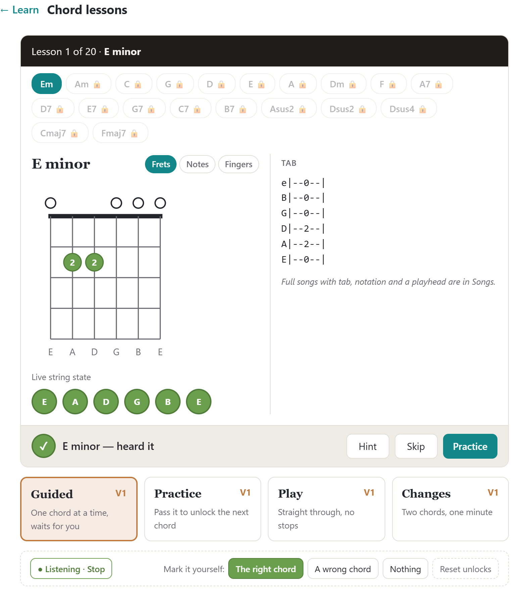

*Figure 2.2. A chord lesson: E minor heard, every string green.*

### 2.3 Live Practice Runs

Both instruments practise songs in the same three modes:

| Mode | Vocal | Guitar |
|---|---|---|
| Listen | Playback, with **Record attempt** to score a sung run | Playback, with tempo, metronome, count-in and loop |
| Wait for me | The cursor holds each note until it is sung in tune. Each note is timed from when it is highlighted: full marks within 1 s, none from 6 s, and notes over 3 s are marked amber. "Hear the note" plays it. | The song waits for the right note or chord. Only the right note, or **Skip**, moves it on. After three wrong tries the screen points to Hint and Skip. |
| Trouble spots | Playback never waits. A note within 50 cents and steady for 60% of its length is right; half a step off is amber and counts half; anything else is a miss (red). | Playback never waits. Each pick or strum is placed on the song's clock and matched to the nearest note within 0.2 s. A note passed with nothing heard is a miss. |

**How a live run works.** Everything during the run happens on the device: the microphone is read many times a second, each reading is matched to what the score expects at that moment, and the result is drawn on the score as it happens. Only the finished try is saved.

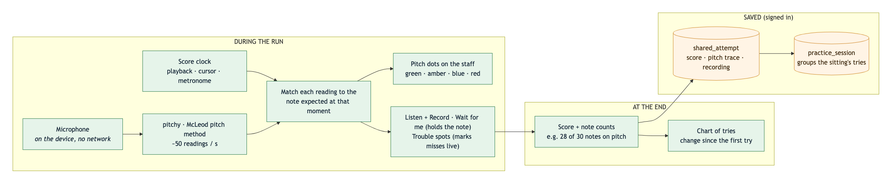

*Figure 2.3a. A live practice run. Green boxes run in the browser with no network; orange is what is saved for a signed-in user.*

**Guitar judging in Wait for me** is strict, because the player can always strum again:

- **Every note of a chord must sound, and nothing else.** A chord one note off (A7 for A, E major for E minor) is not accepted, and the extra note is named.
- **One strum, one judgement.** Onsets within 0.2 s are one gesture.
- **Only fresh playing counts.** The expected notes must get louder at the strum, so strings ringing from the last chord are not counted again.
- **Clicks, taps and typing are not notes.** A sound must be tonal, keep ringing for 0.3 s and stand above the room's noise floor before it is judged.

alphaTab plays on one audio clock and the microphone records on another, so a **latency calibration** plays eight clicks and measures the round trip from speaker to microphone; the median is subtracted from every onset in Trouble spots.

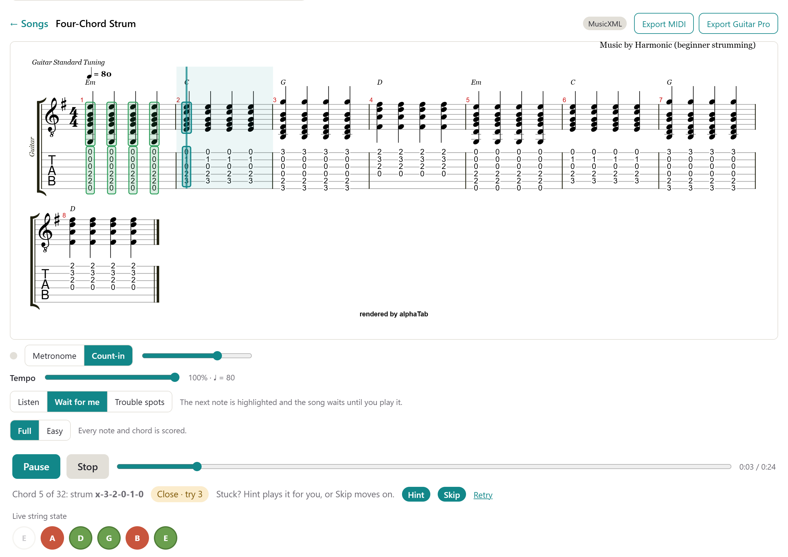

*Figure 2.3b. Guitar Wait for me. The player strummed E minor where C was expected, so the song waits and points at Hint and Skip.*

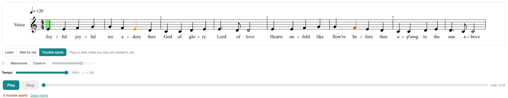

*Figure 2.3c. Vocal Trouble spots: a note half a step off turns amber, a miss red.*

**Practice controls shared by both tabs:**

- **Accompaniment.** "By myself" or "With all parts". While the microphone judges, the user's own part never plays, so the app can't credit its own playback to the user.
- **Metronome.** A click on every beat with the downbeat accented, an optional one-bar count-in, and a volume. The click is filtered noise, so the pitch tracker never takes it for a note.
- **Tempo** from 50% to 100% in 5% steps, remembered per song. A slowed vocal attempt still scores against the written rhythm.
- **Full / Easy** (guitar). Easy scores only the first note of each bar and every chord change; the rest stay on the tab, greyed out.
- **"Tune first?"** (guitar). A banner suggests tuning once per session, and comes back when the player's notes sit more than 25 cents out of tune.
- **Dynamics** (vocal, new at M4). While the microphone listens, a level bar and an arrow show how loud the singer is and which way it is going: ↗ louder, ↘ softer or → steady (Section 4.6).

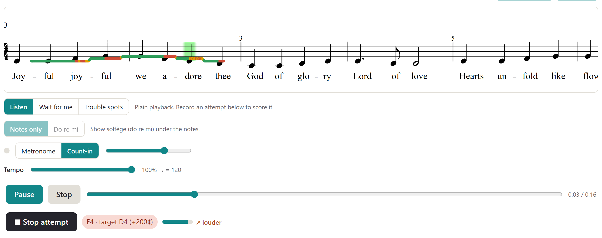

*Figure 2.3d. The dynamics meter during a recorded attempt, next to the note being sung and its target.*

**When the input is too quiet,** guitar says "Couldn't hear you — play a little louder" and counts nothing. On vocal, quiet moments are simply not scored, so silence is never counted as a miss.

### 2.4 Run Summaries and Practice History

Every judged note is marked on the score: green (right), amber (close: the wrong octave, a semitone off, or part of a chord), red (missed) or grey (not scored). On guitar the marks are drawn on a layer over alphaTab, because restyling a note there re-renders the whole score.

**Summaries.**

- **Vocal:** the score, notes hit ("6 of 8 notes hit · 2 missed"), the range of loudness and the swells and fades, and a chart of every try in this session.
- **Guitar Wait for me:** notes played on the first try, after a few tries, and passed with Skip.
- **Guitar Trouble spots:** "Hit 41 of 52 · 6 close · 5 missed", and **Loop bar N**, which loops the first bar with a miss. After the run the recording can be **re-checked** on the device by Basic Pitch, note by note, which corrects the marks and the saved score.

**Practice history (both instruments).** A signed-in user's tries are saved privately:

- **Practice sessions.** Opening a song starts a session; reopening it within 30 minutes resumes it, and **New session** starts a fresh one. Each try shows its time, score, mode, notes hit, recording, a note to self and a 1–5 rating. The **Practice sessions** view in each tab shows one card per song (times practised, attempts, best, last practised) with its sessions. Each tab lists only its own instrument.
- **Guitar run history (new at M4).** Every finished Wait for me or Trouble spots run is saved, with whether it was the Easy version and whether it was a full run. The song shows "Last run 83% · best 83% (3 runs)" from full runs of the current mode, so a looped bar or a stopped run never lowers it.
- **Opened attempt history.** Opening a try shows the user's own note and rating, friends' comments, and every try at the same song with its score, the change from the try before, and the best marked.

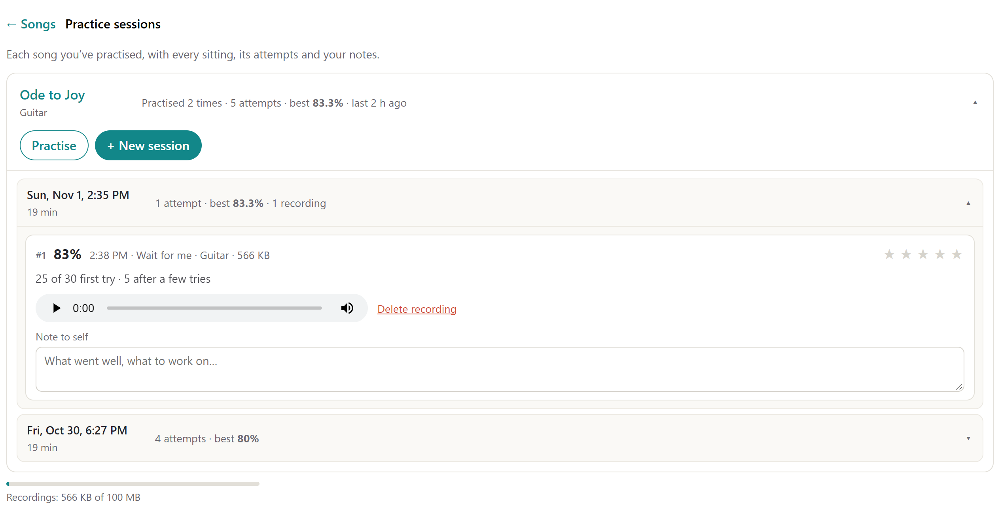

*Figure 2.4a. Guitar Practice sessions on the deployed app.*

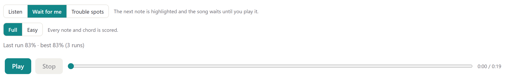

*Figure 2.4b. The song's last and best score in the current mode.*

**Recordings.** Vocal attempts keep a recording only when "Keep recording" is ticked. Guitar runs always keep theirs, because a shared guitar run is played back from it. Recordings are capped at 100 MB per user and can be deleted while keeping the score (Section 5.5).

### 2.5 Home, Social and Sharing

- **Home:** Continue Practice (the latest try, its counts and trouble spots), Working On (songs practised, with best-score bars), Quick Practice, Recent Activity (tries received from and sent to friends, with comments), and **My Files**: song files opened on this device, kept in IndexedDB and never uploaded.
- **Social:** a **name#tag**, an invite link (opening it makes you friends), adding a friend by name#tag, and Friends / Requests / Sent lists.
- **Sharing a try.** **Send to friends** puts a try on their Home; **Copy link** shares it by link. What is sent is the try (score, marks and recording), never the song file: the friend's app redraws the marks on its own copy of the song, matched by catalog id or the file's fingerprint.
- **Sharing a guitar run (new at M4).** The friend's view plays **no MIDI**. The player's recording comes first, and the tab cursor moves along with it: at the tempo it was played for Trouble spots, note by note for Wait for me. Sending waits for the recording to finish uploading, so a run never goes out silent.
- **Comments** from the owner and the friends a try was sent to.

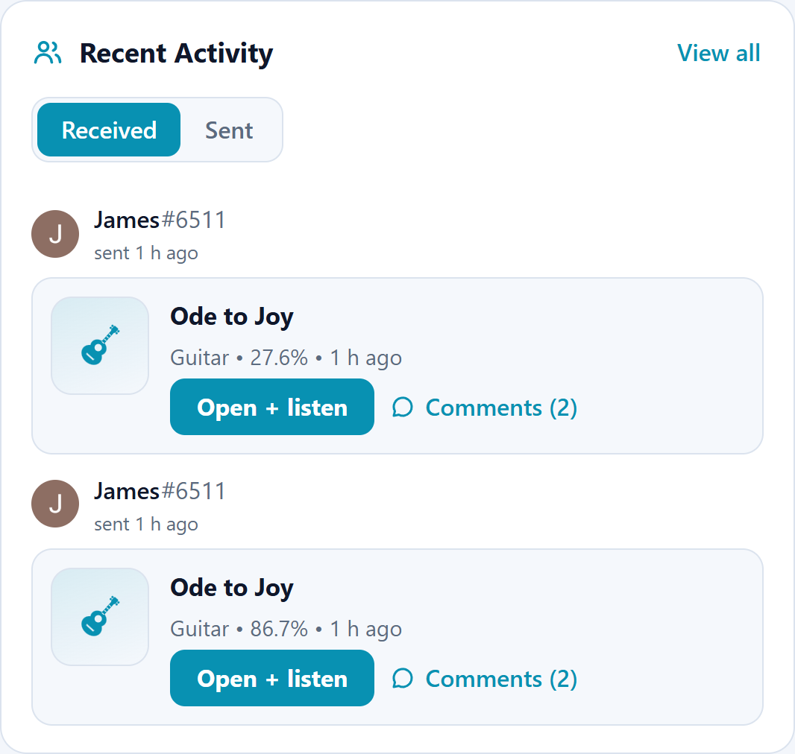

*Figure 2.5a. Received guitar runs on a friend's Home.*

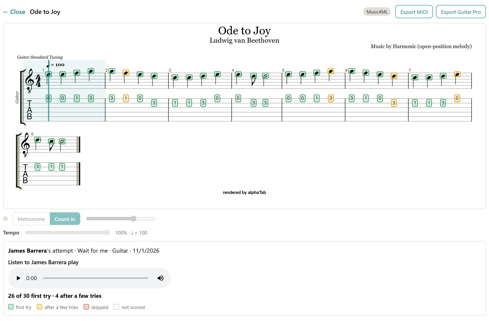

*Figure 2.5b. A received guitar run, opened by the friend: the marks on the friend's copy of the song, and the player's recording in place of the MIDI.*

### 2.6 Notation and Song Files

- **Formats in:** MusicXML, MXL, MIDI, Guitar Pro and alphaTex. Every file becomes one internal score per instrument (Section 5.3).
- **Built-in songs.** Guitar: Ode to Joy, Four-Chord Strum and House of the Rising Sun. Vocal: Amazing Grace, Because, C Major Scale, I've Got a Dream (a cappella), Ode to Joy, Oh Darling and Paint It Black. An online public-domain catalog adds more.
- **Generated tab.** A MIDI or MusicXML file without tab gets it: a Viterbi search chooses a string and fret for every note, keeping the hand's movement small and never stretching past four frets. Parts that don't fit are moved by octaves, and unplayable chords are reduced. A notice says the tab was generated.
- **Solfège (new at M4).** A **Notes only / Do re mi** switch under the vocal score adds a syllable under every note, on its own line beneath the words. It uses movable do (minor keys start on la), raises or lowers chromatic notes as spelled, and works out do from the notes for MIDI files with no key signature. Only the viewer's copy is labelled.
- **Export:** MIDI and MusicXML (vocal), MIDI and Guitar Pro (guitar).

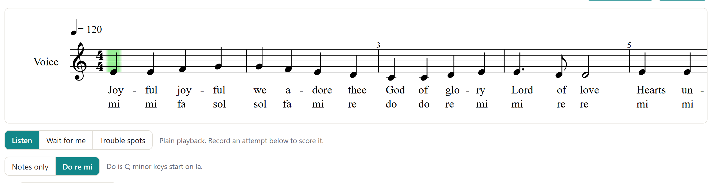

*Figure 2.6. Solfège labels on Ode to Joy, in C.*

### 2.7 Vocal Arranger

Vocal → **Arrange a song for voices**. Harmonic listens to a song's lead vocal and chords and writes an arrangement for voices, which opens as a normal multi-part score to hear, practise one part at a time, and export.

- **Voicings:** Solo + TTBB (default), TTBB, SATB, and two parts (TB).
- **Two ways in:** an audio file the user owns, arranged entirely in the browser; or a **YouTube link**, arranged on the team's server for users on an allow-list, which also adds **lyrics**.
- **How it works:** vocal separation, Basic Pitch for the sung notes, beat tracking, and a chord pass that changes chords only at bar lines or half-bars. The tune is cleaned up, snapped to eighths and moved to a key that suits the singers.

### 2.8 Guitar Tools

- **Tuner:** the nearest string, how many cents off, and hold to confirm.
- **Ear training** (Exercises). Three levels: what kind of chord (major, minor or seventh), which chord (from the chords the player picks; missed ones come back more often), and the chords of the last song opened. Rounds are ten questions. Chords play through a plucked-string synth.
- **Fretboard:** the whole neck to fret 20 with every note labelled, five tunings, and tap a note to hear it and see every place it occurs.
- **Audio to tab (experimental).** Under **Tab the guitar from a song**, an MP3 or WAV (up to 10 minutes) becomes a draft tab of its guitar part, entirely in the browser. Drafts are kept under **My transcriptions** and open like any song.

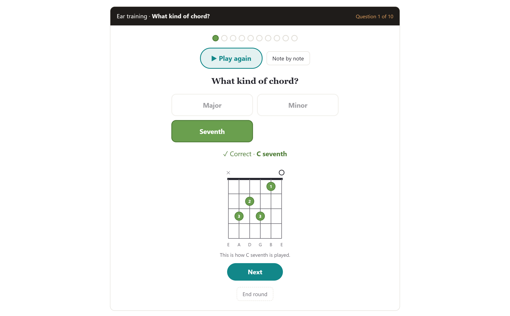

*Figure 2.8a. Ear training, "What kind of chord?"*

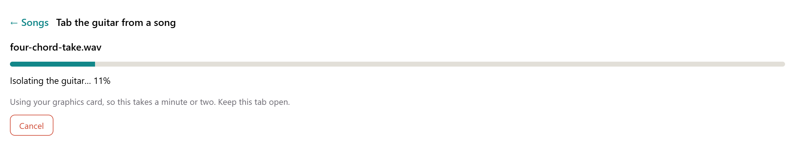

*Figure 2.8b. Audio to tab in progress.*

---

## 3. Core Audience

Harmonic is for students that existing instrument tools don't serve well.

### 3.1 Independent Learners

Self-directed beginners with no instructor. The Learn path gives them an order: chords unlock one at a time, strumming builds from muted strums up, and the soft gate (Unlock anyway, Skip) keeps imperfect detection from stopping them. Ear training teaches them to hear the difference between, say, E major and E minor, so they can tell for themselves whether they played the right chord.

### 3.2 Stranded Intermediates

Players past the beginner stage with no clear next step. They can practise any song they choose: a file without tab gets tab, and a recording can become a draft. Trouble spots shows exactly where a run goes wrong, Loop bar drills that spot, and the run history shows whether it is getting better. A run can be sent to a friend or teacher, who hears it and comments.

### 3.3 Returning Musicians

Lapsed players with some technique left. Tempo control and the Easy version let them start below full difficulty and work back up; ear training rebuilds hearing, and Changes mode rebuilds the fretting hand. Progress and history are on the account, so practice on a phone and on a laptop add up.

### 3.4 Choir and A Cappella Singers

Singers learning a part. They practise their own part with or without the others, see each note marked, keep a history of their tries, read the part in solfège if that is how they learn, and use the arranger for songs that have no published arrangement.

---

## 4. Software Stack

### 4.1 Frontend

- **App:** React 19 + Vite, packaged as an installable PWA that works offline. Heavy parts (alphaTab, the models) load only when first used.
- **Notation:** OpenSheetMusicDisplay for voice, whose cursor gives the timing and expected notes, so playback, cursor and scoring share one clock. alphaTab for guitar, the only web renderer that draws tab; the song timeline is built from its own MIDI ticks.
- **Playback:** Tone.js for voice; alphaTab's synth for guitar; Tone.js `PluckSynth` for chords and hints.
- **Listening:**
  - Voice: pitchy (McLeod pitch method) about 50 times a second, which also gives the level for dynamics.
  - Guitar: a shared AudioWorklet capture feeding the tuner, the lessons and the song judge. The song judge is score-informed: it looks for the notes the score expects (each one's fundamental and overtones) among the spectral peaks just after a pick or strum, using an FFT written in JavaScript.
- **Models, loaded only when used:** Basic Pitch (TensorFlow.js); Demucs, YAMNet and Beat This! (ONNX Runtime Web, on the graphics card through WebGPU when there is one).
- **Browser storage:** IndexedDB for My Files and transcription drafts; localStorage for settings (tempo, Easy, metronome, latency, label and solfège switches, ear-training statistics) and the browser's copy of Learn progress.
- **Live audio never leaves the device.** Only finished tries, their recordings, and progress are uploaded.

### 4.2 Backend and System Overview

Supabase is the only backend service. It provides:

1. **Sign-in** with Google or GitHub, which issues the login token (JWT).
2. **The public catalog:** song rows plus their files, readable without an account.
3. **Attempts:** every finished try, vocal or guitar, saved privately, sent to friends or shared by link, with comments.
4. **Practice sessions,** scored vocal runs, owner notes and ratings, and the recording budget.
5. **Social:** profiles with name#tag, friendships and invite codes.
6. **Guitar Learn progress.**
7. **Arrangement jobs:** a queue and a private bucket for the arranger worker's results.

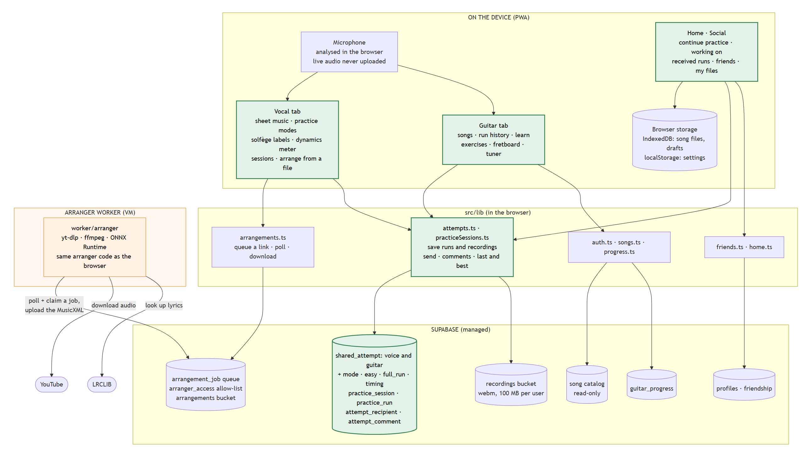

*Figure 4.2. System overview at M4. Everything in the top box runs on the user's device; `src/lib` is TypeScript in the browser, not a server; the orange box is the only code that runs outside the browser. Green boxes changed for M4.*

### 4.3 Schema

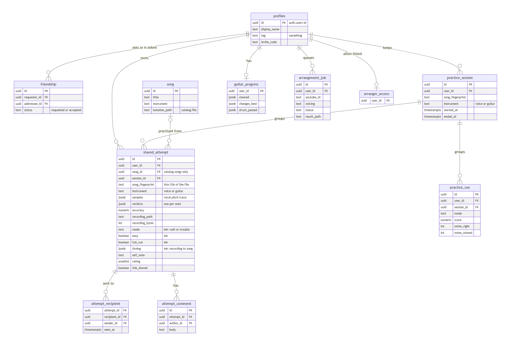

*Figure 4.3. The tables in use at M4 and their main columns. Every table has row-level security.*

`shared_attempt` is the history for both instruments: one row per finished try, with a pitch trace (vocal) or a verdict per note (guitar), the score, the recording's path and size, and the session it belongs to. The M1 progress tables (`run_through`, `recording`, `lesson_progress`, `song_pref`) still exist but are unused, because `shared_attempt` already held everything a run needs.

| Migration | Adds | Access |
|---|---|---|
| 0001 `init` | `profiles`, `song`, and the M1 progress tables | own rows |
| 0002–0004 | Seed songs, the public catalog and its read access | catalog read-only |
| 0005 `shared_attempts` | `shared_attempt`, `get_shared_attempt()`, and read access to a shared try's recording | owner; one attempt by id |
| 0006, 0007 | The guitar catalog copy of Ode to Joy; guitar attempts (`instrument`, `verdicts`) | as `shared_attempt` |
| 0008 `user_handles` | name#tag, invite codes, `find_user_by_handle()` | own row; lookup by exact handle |
| 0009 `friendships` | `friendship`: request, accept, decline, unfriend | the two people involved |
| 0010 `attempt_sharing` | Private by default, `attempt_recipient`, `attempt_comment`, `can_view_attempt()` | owner and the friends it was sent to |
| 0011, 0012 | `arranger_access`, the `arrangement_job` queue, the `arrangements` bucket; the Solo + TTBB voicing | own jobs; the worker uses the service role |
| 0013 `guitar_progress` | Chords cleared, Changes bests, strum steps | owner only |
| 0014 `practice_sessions` | `practice_session`; note, rating and recording size on attempts; the recording budget trigger | owner only; notes hidden from others by `get_shared_attempt()` |
| 0015 `practice_runs` | `practice_run`: scored vocal Wait for me / Trouble spots runs | owner only |
| **0017 `guitar_run_history`** | On `shared_attempt`: `mode` (wait or trouble), `easy`, `full_run`; an index for the last and best score | as `shared_attempt` |
| **0018 `attempt_recording_timing`** | On `shared_attempt`: `timing`, points of recording seconds against song seconds | as `shared_attempt` |

### 4.4 TypeScript Layer (`src/lib`)

The app calls a small TypeScript layer in the browser, not a server, which talks to Supabase over HTTPS with the user's JWT:

- `auth.ts`: sign-in, session, sign-out.
- `songs.ts`: the catalog and time-limited download links.
- `attempts.ts`: save a try privately, attach its recording (as raw bytes, within the budget), send to friends, comments, open by id, the tries at a song, and, new at M4, a guitar run's mode, Easy, full-run and timing fields and the song's last and best score (`listSongScores`).
- `practiceSessions.ts`: start, resume and end sessions, list them per instrument, notes and ratings, delete a recording, storage used.
- `practiceRuns.ts`: scored vocal runs.
- `friends.ts`, `home.ts`: name#tag, friends and invites; Home's lists.
- `progress.ts`: guitar Learn progress.
- `arrangements.ts`: queue an arrangement from a link, poll it, download it.

### 4.5 Main Data Flows

- **Open a song:** built-in files come with the app, catalog songs through a time-limited link, and the user's own files stay on the device. The file becomes a score in memory and goes to the renderer.
- **Finish a try (signed in):** the score, the pitch trace or per-note verdicts, and the part are saved as a private `shared_attempt` row in the current practice session. For guitar this also stores the mode, Easy, full run and timing. The recording is uploaded to the private `recordings` bucket and counted against the 100 MB budget: always for guitar, when ticked for vocal.
- **Last and best:** the song asks for its full runs of the current mode, newest first, and shows the newest and the highest.
- **Send to friends:** `attempt_recipient` rows are added once the recording is uploaded; the try and its recording become readable to those friends, and it appears on their Home.
- **Open a shared try:** fetched through `get_shared_attempt()`, redrawn on the viewer's copy of the song. A guitar run plays its recording, and its timing moves the cursor.
- **Arrange from a link:** the app inserts an `arrangement_job`; the worker claims it, runs the models, writes the result to the `arrangements` bucket and marks it done; the app downloads and opens it.

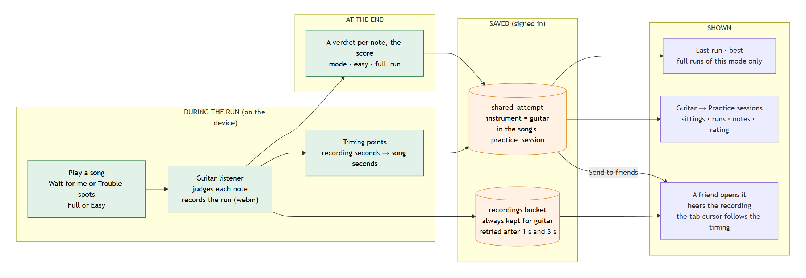

*Figure 4.5a. A guitar run, from playing to its history. Green runs on the device; orange is saved for a signed-in user.*

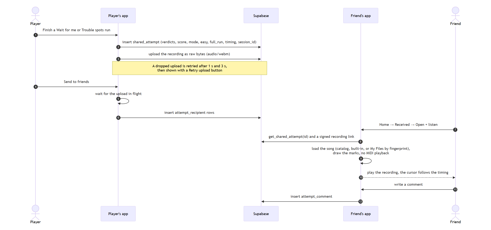

*Figure 4.5b. Sharing a guitar run, step by step.*

### 4.6 Listening on the Device

**Guitar.** Microphone frames become listening windows. Onsets come from three sources: a jump in level (a strum), new frequencies over ringing strings (an arpeggio), and a new stable pitch with no attack (hammer-ons, pull-offs, slides). Wait for me and the lessons pass each window through the noise gate; Trouble spots places it on the song clock. The judge then looks for the expected notes among the spectral peaks.

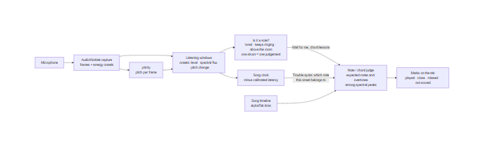

*Figure 4.6a. The guitar listening pipeline.*

**Voice: dynamics and solfège (new at M4).** Dynamics reads the level pitchy already measures for every frame, so no new audio processing was added. Solfège is computed from the score, not the microphone: it adds a lyric line to the viewer's copy of the MusicXML.

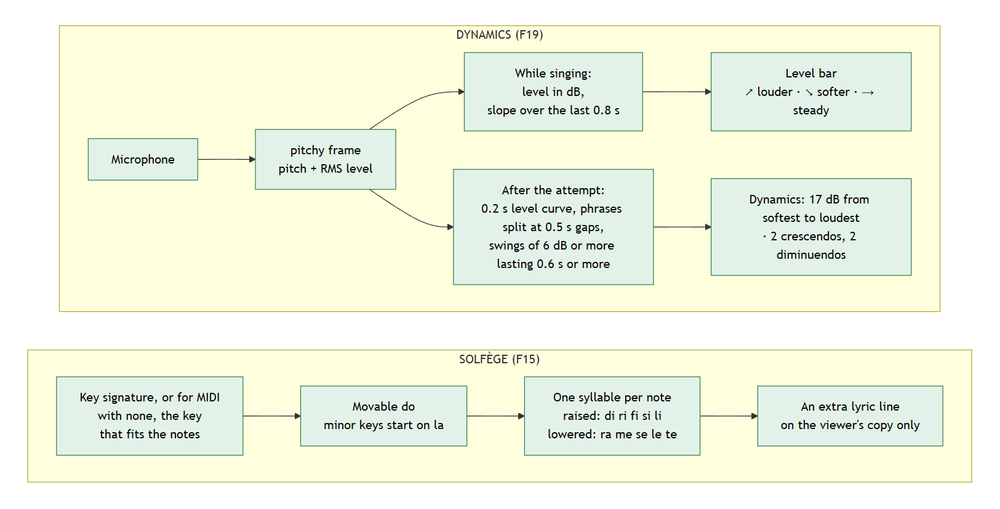

*Figure 4.6b. How dynamics and solfège work. Both run in the browser.*

**Audio to tab.** Decode, detect the guitar (YAMNet), separate it (Demucs), transcribe its notes (Basic Pitch), clean up, find the beat (Beat This!), and write a draft score.

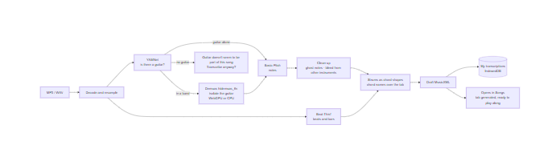

*Figure 4.6c. Audio to tab, entirely in the browser.*

### 4.7 Arranger Worker

The only code that runs outside the browser. A Node process in `worker/arranger/` on a team VM (16 vCPU, 15 GB RAM) polls `arrangement_job`, gets the audio with yt-dlp and ffmpeg, runs the same arranger code as the browser plus Whisper for lyrics, and writes the result back to Supabase. A 4-minute song takes about five and a half minutes on CPU.

It cannot run on Supabase or Vercel: Edge Functions allow 2 seconds of CPU and 256 MB of memory with no native binaries, Vercel functions cap memory at 2 GB and run time at 300 s, and one arrangement is minutes of model inference in about 4 GB. Any host that can run a Node process can run the same worker, because it talks to Supabase only over HTTPS.

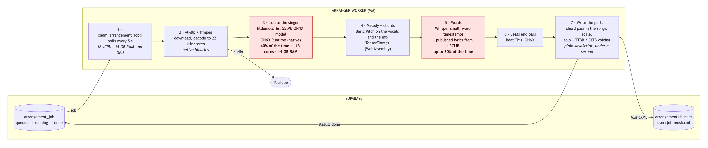

*Figure 4.7. One arrangement on the worker. Isolating the singer and finding the words take most of the time: 332 s in all for a 4-minute song.*

---

## 5. Architecture Rationale

### 5.1 Scalability

Every analyzer emits the same kind of event, timestamped by the same clock that drives playback and the cursor, so the scoring logic doesn't need to know which analyzer produced it. Practice sessions and attempt history are instrument-agnostic: at M4, guitar runs use the same tables as vocal attempts, with four extra columns.

**Where the work runs decides how Harmonic scales.** The expensive part of a run, listening and scoring, runs on each user's own device, so it grows with users at no cost to us. The server sees one small row per finished try, plus its recording. The arranger is the one heavy server job, and its queue is claimed with `FOR UPDATE SKIP LOCKED`, so more workers can be added on any host without code changes.

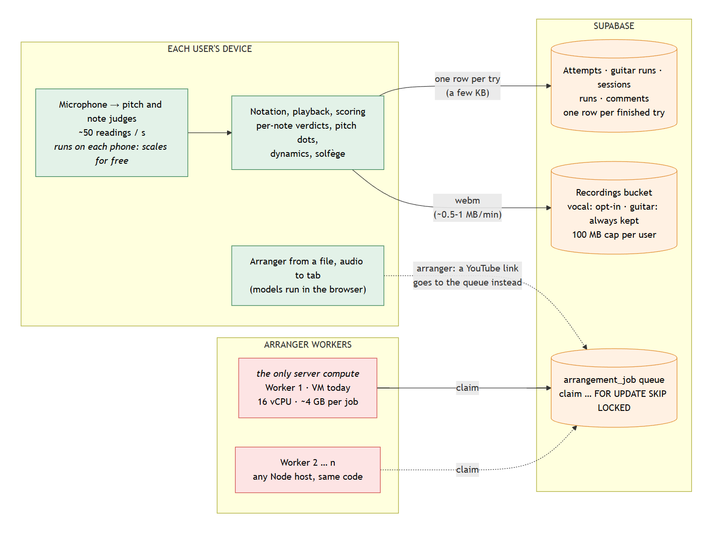

*Figure 5.1a. Green scales for free with users; orange is budgeted (rows are small, recordings are capped at 100 MB per user); red is the only server compute, and it scales by adding workers.*

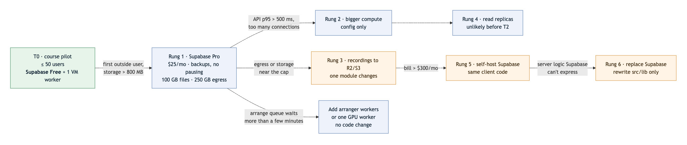

*Figure 5.1b. The [scaling plan](../docs/scaling-plan.md). Today Harmonic is at T0: Supabase Free plus one VM worker. Every step before the last is configuration or a change to one module, because the client talks to the backend only through `src/lib`.*

### 5.2 Real-Time Responsiveness

The microphone is analysed in the browser, so there is no network in the loop. M1 set a target of under 100 ms from microphone to score. We kept latency as low as the browser allows (its audio filters off, short windows), and calibrate it where timing matters, but we chose **right over fast**: a guitar verdict waits until a strum is over (0.2 s) and, in Wait for me, until the note has rung for 0.3 s, so that clicks, taps and ringing strings are never judged. The vocal pitch trace and the dynamics meter stay live.

### 5.3 Standardization

The app accepts music files in any common format, processed on the user's device. Every file becomes one internal score per instrument: MusicXML for voice, and an alphaTab score with a tick-based timeline for guitar. Playback, cursor, judging and the metronome all read that one score, so tempo changes never move a note. The arranger, generated tab and audio-to-tab drafts are written in the same formats, so they flow into the same renderer, modes and scoring with no special cases. Solfège and the shared-run cursor are layered on top, never written into the file.

### 5.4 Code Leanness

There is no custom API server. Authorization lives in Postgres: every table has row-level security scoped to the signed-in user, friends' access goes through `can_view_attempt()` and security-definer functions, and the catalog is the only public data. The M4 features added four columns in two migrations, and no new tables. The arranger worker holds no state of its own.

### 5.5 Storage Budget

Supabase's free tier allows 1 GB of file storage, 5 GB of egress a month and 50 MB per file. Scores, verdicts, notes and timing are small and always kept. Audio is the only large data, so it is capped at 100 MB per user by a database trigger and can be deleted while keeping the score. Vocal recordings are opt-in. Guitar recordings are always kept, because a shared guitar run is played from its recording; at about 0.5–1 MB a minute, that is 100–200 minutes of runs. When the budget is full, the run is still saved with its score, and the app asks the player to delete some recordings.

---

## 6. Known Gaps and Next Steps

- **iPhone Safari (N2).** Audio starts from a tap, as iOS requires, but the app has not been tested on a real iPhone. One full pass is planned before the final demo ([test plan](M4-test-plan.md), case A4).
- **Firefox recording uploads.** Uploads failed in Firefox; PR #48 sends recordings as raw bytes, which still needs a confirming test there.
- **Vocal summaries can't be clicked** to jump to a spot (F24). Guitar has Loop bar.
- **Vocal noise rejection** is only a clarity threshold and a level floor (N6).
- **Private notes and a raw query.** A friend a try was sent to could read the owner's note and rating with a hand-built database query; the app never shows them. Fix: move them to an owner-only table.
- **Guitar thresholds** were first tuned on simulated strings and are being tuned on real recordings. Trouble spots does not yet use Wait for me's stricter rules.
- **Tempo is remembered per device,** not on the account.
- **Audio to tab** is an early draft, with no accuracy measure on real songs.
- **Arranger accuracy:** chord recognition on dense mixes still confuses relative major and minor chords.

---

## 7. Trade-offs

M4 asked what we cut and what we refused to cut. Each cut below was a decision, usually forced by what real playing and singing showed.

### 7.1 What we cut

| Planned | What we did | Why |
|---|---|---|
| Lessons for vocal (F2, F3) | Dropped | Vocal is a training tool for singers learning a part, not a lesson app. Its loop is practice sessions, the chart of tries and attempt history. |
| A lesson map with stages for guitar (F2) | An exercise path: 20 chords that unlock in order, plus Strum on the beat | Testers lost track of which stage they were on. A path lets an experienced player clear it quickly and a beginner take their time. |
| Concept → drill → play in every lesson (F3) | Exercises have their own tab | It was hard to say where a drill belonged in the path. Players now choose when to do it. |
| Auto-skip after three misses (F13, F29) | Only the right note or Skip moves on; after three misses the app points at Hint and Skip | On real guitars it moved on after wrong notes, and testers found it confusing. |
| A chord cleanliness score (F17) | A clear verdict per string: rang clean, or buzzed or wrong | From the microphone, leftover buzz from an earlier strum sounds like a wrong note played a little early or late. A score would only be a guess. |
| Strum direction and patterns (F18) | Timing only: early, on time or late | A down-strum and an up-strum on the same chord sound too alike to tell apart. |
| Latency under 100 ms (N1) | Kept low and calibrated; guitar verdicts take a few hundred milliseconds | Telling a real note from a click or a ringing string needs the note to ring for a moment. |
| Early / late ratings for every note on songs (F11) | Notes hit per run, with a grace window | Pitch is what the microphone can judge reliably. Timing is rated where it is the point: Strum on the beat. |
| "Couldn't hear you" on vocal (F21) | Quiet moments are simply not scored | Silence is never counted as a miss, which was the goal; a message added nothing. Guitar keeps its message. |
| Logging every miss, skip and auto-advance in the notation | Notes are marked; skips are counted in the summary | Auto-advance was removed, and the marks already show where a run went wrong. |
| Random exercises and progressions (F20, F36) | The player picks the chords to train; Play mode uses the chords they have learned | Random chords a beginner hasn't learned yet aren't practice. |
| Save as PDF (M2) | Dropped; never merged | Copy link and Send to friends cover the same need inside the app. |
| Tempo in Changes mode (F38, a Won't) | Changes mode was built anyway, without the tempo | Time and complexity. |
| Group sessions (F26, a Won't) | Social without sync: send a finished try to friends, who comment | Live sessions were out of scope; asynchronous sharing gives most of the value. |

### 7.2 What we refused to cut

- **Judging on the device.** Live audio never leaves the user's phone or laptop. It costs us model downloads and careful performance work, but it keeps practice private, works offline, and scales with users at no cost (Section 5.1).
- **The soft gate.** Imperfect detection must never trap a beginner: Unlock anyway, Skip, and Next are always there, and the microphone never changes a lesson's chord on its own.
- **Right over fast.** No verdicts on noise, clicks or ringing strings, even when that makes a verdict slower (Section 5.2).
- **A run never goes out silent.** When testing showed shared guitar runs arriving without audio, we made guitar recordings always kept and made sending wait for the upload, rather than let a friend open a run they can't hear.
