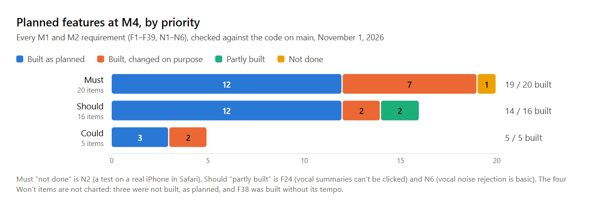
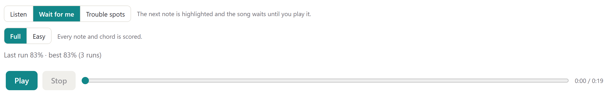
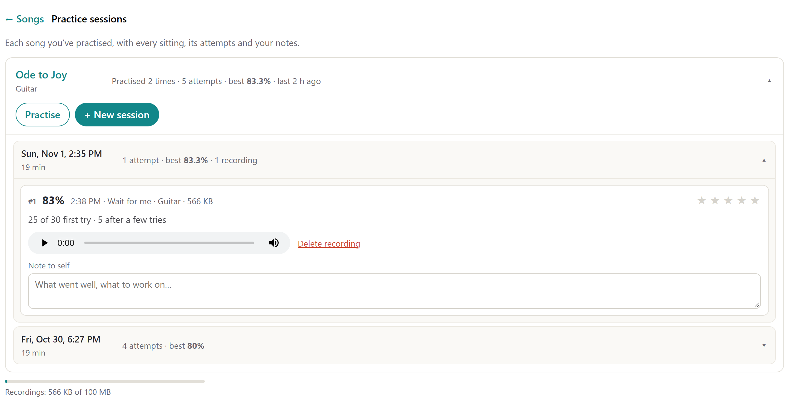
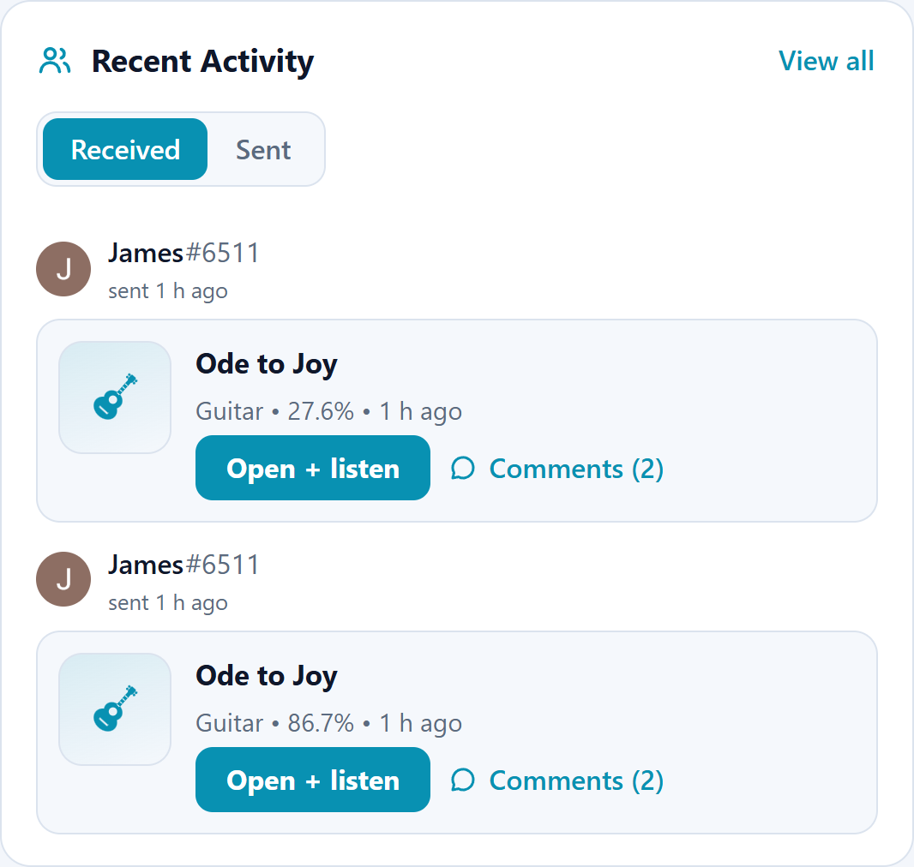
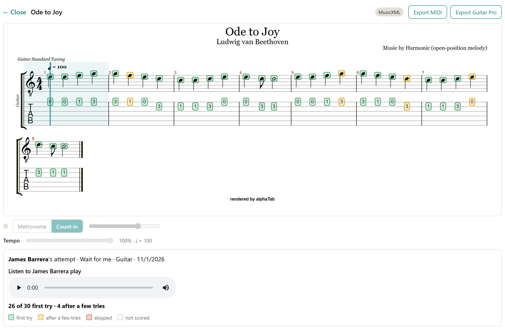
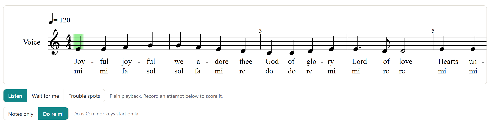
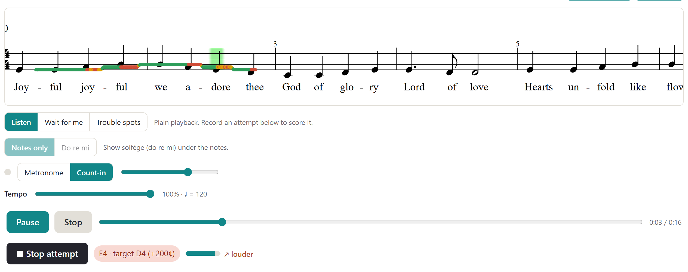
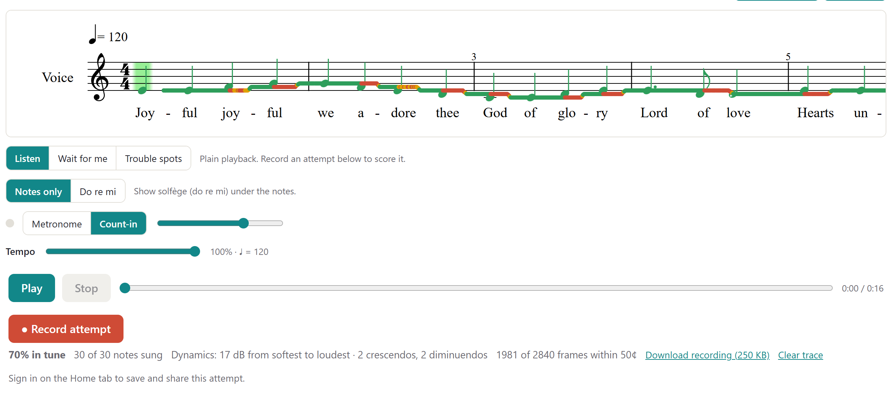

# Harmonic — Milestone 4: Implementation of Planned Features

**Last Updated: Milestone 4 (Sunday, November 1, 2026)**

This document checks every feature Harmonic planned at Milestone 1 (requirements F1–F39 and N1–N6) and Milestone 2 against the code on `main` (commit `2685822`, pull request #48) and the deployed app at **https://harmonic-vert.vercel.app**. For each feature it gives the status, where it is in the app, how it is built, and how it differs from the plan.

The other M4 documents are the [design document](M4-design-document.md), which also has the full trade-offs section, and the [test plan](M4-test-plan.md).

---

## 0. Summary

*Figure 0. Every M1 requirement by MoSCoW priority. "Changed" means built, but deliberately different from the plan; the reasons are in Section 2 and in the design document's trade-offs section.*

| Priority | Items | Built as planned | Built, changed on purpose | Partly built | Not done |
|---|---|---|---|---|---|
| Must | 20 | 12 | 7: F2, F3, F11, F13, F21, F29, N1 | — | 1: N2 |
| Should | 16 | 12 | 2: F17, F18 | 2: F24, N6 | — |
| Could | 5 | 3 | 2: F20, F36 | — | — |
| Won't | 4 | F25, F26 and F27 were not built, as planned. F38 was built anyway, without its user-set tempo. | | | |

**What changed since Milestone 3 (October 21).** Three requirements that were open at M3 are now built, and the guitar run history was hardened after testing:

| Pull request | What it added | Requirement |
|---|---|---|
| #43 | Solfège labels under the vocal notes | F15 (was partly built) |
| #43 | Dynamics: a louder / softer meter while you sing, and the range and swells after an attempt | F19 (was not built) |
| #44 | Guitar run history: Wait for me and Trouble spots runs saved into practice sessions, with the last and best score | F22 (was partly built) |
| #45 | A shared guitar run plays the player's recording instead of the song's MIDI; Wait for me runs are recorded too | F22, F23 |
| #46 | A shared guitar run's tab cursor follows the recording | F22 |
| #47 | Guitar runs always keep their recording; a failed upload is retried and can be retried by hand | F23 |
| #48 | Recordings are uploaded as raw bytes, after uploads failed in Firefox | F23 |

**Status words used below:**

- **Built**: built as planned, or close enough.
- **Changed**: built, but deliberately different from the plan.
- **Partly**: part of it is built.
- **Not done**: not built or not verified.
- **Won't**: planned not to be built in V1.

---

## 1. Finished for Milestone 4

### 1.1 Guitar run history (F22)

At M3, only the Vocal tab kept a history: a guitar run could be shared as a link but was never saved. Now every finished guitar run on a song is kept, the same way as a recorded vocal attempt.

- **What is saved.** When a signed-in player finishes a **Wait for me** or **Trouble spots** run, it is saved privately as an attempt in the song's practice session. The attempt holds a verdict for every note, the score, the run's recording, and three new facts: the mode, whether it was the **Easy** version, and whether it was a **full run** (from the first scored note to the end). Migration `0017_guitar_run_history` adds those three columns.
- **Last run and best.** Under the mode buttons, the song shows "Last run 83% · best 83% (3 runs)". Only full runs of the same mode count, so a looped bar or a run stopped halfway is kept but never lowers the score. For Wait for me, the score is the share of notes played on the first try.
- **Practice sessions for guitar.** Guitar → Songs → **Practice sessions** lists each song practised on guitar, with every sitting and its runs, their recordings, a note to self and a 1–5 rating. Each tab lists only its own instrument.
- **Corrected after the re-check.** When a Trouble spots run is re-checked note by note (Basic Pitch, after the run), the saved score is corrected too.

*Figure 1.1a. Ode to Joy in Wait for me. The line under the buttons comes from the player's full Wait for me runs at this song.*

*Figure 1.1b. Guitar → Practice sessions on the deployed app. Each sitting lists its runs; this Wait for me run played 25 of 30 notes on the first try and kept its 566 KB recording.*

### 1.2 Sharing a guitar run with its recording (F22, F23)

Testing PR #44 showed that a friend who opened a shared guitar run heard the song's MIDI, not the player. Three fixes followed:

- **The friend hears the player** (#45). The shared view plays no MIDI. The player's recording comes first ("Listen to James Barrera play"), and Wait for me runs, which were not recorded before, are now recorded from the first Play to the last note. Pausing keeps one recording.
- **The cursor follows the recording** (#46). Each run is saved with timing points that map seconds of the recording to seconds of the song (migration `0018_attempt_recording_timing`). While the recording plays, the friend's tab cursor moves to the note being played: at the tempo it was played in Trouble spots, and note by note in Wait for me.
- **A guitar run never goes out silent** (#47, #48). Guitar runs always keep their recording, with no checkbox. A dropped upload is retried after 1 s and 3 s, and then shown with a **Retry upload** button. **Copy link** and **Send to friends** wait for the upload. After uploads failed in Firefox, recordings are sent as raw bytes instead of a form (#48).

*Figure 1.2a. A friend's Home. Received guitar runs appear under Recent Activity with their score and comments.*

*Figure 1.2b. The 86.7% run opened by the friend. The marks are drawn on the friend's own copy of the song (green first try, amber after a few tries), and the player's recording plays instead of the MIDI.*

### 1.3 Solfège labels (F15)

Choir and a cappella singers often learn parts in solfège. A **Notes only / Do re mi** switch under the vocal score adds a syllable under every note, on its own line beneath the words. It is off by default and remembered on the device.

- **Movable do.** Do is the tonic of the major key the signature names, so minor keys start on la.
- **Chromatic notes** are raised (di ri fi si li) or lowered (ra me se le te) as they are spelled. Chords get one label, and tied notes are not labelled twice.
- **MIDI files** usually have no key signature and convert as C. When the notes fit another key much better, do is worked out from the notes and the hint says so.
- **Only the viewer's copy** is labelled. Exports, sharing and scoring are unchanged.

*Figure 1.3. Ode to Joy with Do re mi on. The hint reads "Do is C; minor keys start on la."*

### 1.4 Dynamics (F19)

While the microphone listens (Record attempt, Wait for me and Trouble spots), a level bar and an arrow show how loud the singer is and which way it is going: ↗ louder, ↘ softer or → steady. The arrow follows the slope of the level over the last 0.8 s. After a recorded attempt, the result line gives the range from softest to loudest and counts the crescendos and diminuendos: swells or fades of at least 6 dB lasting at least 0.6 s within a phrase.

Both read the RMS level that the pitch tracker already measures, so no new audio processing was added. Microphones are not calibrated, so the app reports changes in level, not absolute loudness, and does not score the score's own markings (p, f, hairpins).

*Figure 1.4. Dynamics on the deployed app, sung into a simulated microphone: Ode to Joy at the written pitches, swelling and fading every 4 seconds. Top: the meter during the first swell. Bottom: the attempt's result line.*

---

## 2. Every planned feature

### 2.1 Accounts and lessons

| ID | Pri | Planned (M1) | Status | Where it is and how it's built | Differs from the plan |
|---|---|---|---|---|---|
| F1 | M | Accounts; progress saved to the account | Built | Sign-in with Google or GitHub (Supabase Auth). Saved per user: guitar Learn progress (`guitar_progress`), attempts and practice sessions for both instruments, and scored vocal runs (`practice_run`). | The UI offers OAuth only. The M1 progress tables (`lesson_progress`, `run_through`, `song_pref`, `recording`) are unused: `shared_attempt` became the history. |
| F2 | M | Unlocking lesson map (Duolingo-style) | Changed | Guitar → **Learn** is an exercise path: 20 chords unlock in teaching order, and Strum on the beat has 5 steps. Progress follows the account. | **Guitar:** testers lost track of the map's stages, so it became an exercise path. **Vocal:** no lessons; Vocal is a training tool, and its learning loop is practice sessions and attempt history. |
| F3 | M | Lesson = concept → instrument-free drill → played exercise | Changed | The parts exist as separate views. Learn: chord lessons in Guided, Practice, Play and Changes modes. Exercises: ear training, the instrument-free drill. | Exercises moved to their own tab, so players choose when to do them instead of following a fixed order. No separate concept stage. No vocal lessons. |

### 2.2 Practice pieces

| ID | Pri | Planned | Status | Where it is and how it's built | Differs |
|---|---|---|---|---|---|
| F4 | M | Three built-in songs | Built | Guitar: Ode to Joy, Four-Chord Strum, House of the Rising Sun. Vocal: seven built-in files (Amazing Grace, Because, C Major Scale, I've Got a Dream (a cappella), Ode to Joy, Oh Darling, Paint It Black). Plus an online public-domain catalog. | More songs than planned. |
| F5 | M | Tab and notation | Built | alphaTab for guitar (tab and staff), OpenSheetMusicDisplay for voice. | Files without tab get generated tab. |
| F6 | M | Reference playback toggle | Built | "By myself / With all parts". The player's own part is muted while the microphone judges. | A shared guitar run plays the player's recording, not the MIDI (#45). |
| F7 | S | Click or drag to seek | Built | Guitar: click the tab, or seek in Wait for me and Trouble spots. Vocal: a seek slider. | Vocal seeks with a slider, not by clicking the score. |
| F8 | S | Countdown before a run | Built | A one-bar metronome count-in; 3-2-1 in guitar Play mode and Strum on the beat. | — |
| F9 | S | MusicXML import | Built | MusicXML, MXL, MIDI, Guitar Pro and alphaTex. | More formats than planned. |
| F10 | C | MIDI conversion; guitar MIDI → tab; export | Built | MIDI → MusicXML; generated tab for any MIDI or MusicXML; export MIDI and MusicXML (vocal), MIDI and Guitar Pro (guitar). | Went further: audio → tab (Section 3). |

### 2.3 Listening and scoring

| ID | Pri | Planned | Status | Where it is and how it's built | Differs |
|---|---|---|---|---|---|
| F11 | M | Real-time pitch detection; each note hit, late or missed | Changed | Vocal: pitchy about 50 times a second. Guitar: a score-informed FFT note judge. Notes are marked hit, close or missed as you go, and each run ends with notes hit ("6 of 8 notes hit · 2 missed"). | The verdict is on **pitch, counted per run**, not an early/late rating per note. Trouble spots allows a grace window (0.2 s on guitar). Only Strum on the beat rates timing. |
| F12 | M | Live display of the sung note | Built | Pitch dots and a trace under the staff, coloured in tune, close, other octave or wrong. | — |
| F13 | M | Guided mode: 3 misses → auto-skip; hint | Changed | **Wait for me** on both instruments and guided chord lessons. Hint: guitar plays the chord; vocal plays the note. | **No auto-skip**: it moved on after wrong notes on real guitars. Only the right note or Skip advances; after three misses the guitar points at Hint and Skip. Vocal has no Skip button (seek only). |
| F14 | S | Practice / Play mode with post-run analysis | Built | **Trouble spots** for both instruments, with a summary; guitar Play mode with an end score. | — |
| F15 | S | Label toggle / solfège | **Built at M4** | Vocal: **Notes only / Do re mi** (Section 1.3, #43). Guitar: chord diagrams switch between Frets, Notes and Fingers. | Movable do only; fixed do is not offered. |
| F16 | M | Guitar chord verification | Built | Chroma templates for the lessons. A strict note judge for songs: every chord note must sound, nothing extra, and only freshly played notes count. | Stricter than planned: A7 for A is rejected and the extra note named. |
| F17 | S | Chord cleanliness / fuzziness | Changed | Each string lit green ("rang clean") or red ("buzzed or wrong"), live. | **No cleanliness score:** from the microphone, a string still buzzing from before sounds like a wrong note, so a score would be a guess. |
| F18 | S | Strumming pattern and timing | Changed | Strum on the beat: 5 steps, each strum early, on time (±60 ms) or late, and a habit line ("You rush by about 40 ms"). | **Timing only:** down- and up-strums on the same chord sound too alike to tell apart, so direction and patterns are not checked. |
| F19 | C | Dynamics (volume rising / falling) | **Built at M4** | Vocal: a level meter with louder / softer / steady while singing, and the range and swells after an attempt (Section 1.4, #43). | Vocal only. Reports changes in level, not absolute loudness, and doesn't score the score's markings. |
| F20 | C | Random exercise generation | Changed | Ear training quizzes the chords the player picks, in random order, bringing back the ones they miss. "Chords from my song" uses the last song opened. | The player chooses what to practise; no freely generated melodies. |
| F21 | M | "Couldn't hear you" instead of a miss | Changed | Guitar: a noise gate and "Couldn't hear you — play a little louder". | **Vocal: no message.** Quiet frames are simply not scored, so silence is never a miss. |

### 2.4 Guitar practice modes

| ID | Pri | Planned | Status | Where it is and how it's built | Differs |
|---|---|---|---|---|---|
| F28 | M | Learn mode with a soft gate | Built | Practice mode: three clean strums in a row, each within five seconds, clear a chord. After three timed-out runs, **Unlock anyway** appears. | — |
| F29 | M | 3 misses → auto-skip | Changed | Removed on purpose. Misses are counted, and the player moves on with a chord choice, Skip or Next. | Testers found auto-advancing confusing. |
| F30 | M | Manual skip | Built | Skip in lessons and in guitar Wait for me. | Vocal Wait for me seeks instead. |
| F31 | S | Hint that shows the fingers | Built | Hint plays the chord through a plucked-string synth, and the diagram's dots pulse in finger order. | — |
| F32 | S | Play mode | Built | Chords go by every 5 s, then a score. | A clean strum moves on early. The chords are the last four learned. |
| F33 | S | Post-run analysis on the notation | Built | Green, amber, red and grey boxes on a layer over the tab. After the run, a Basic Pitch re-check, which now also corrects the saved score. | The re-check is extra. |
| F34 | S | Live chord state | Built | Per-string lights and a status banner. | — |
| F35 | S | Diagram label toggle | Built | Frets, Notes, Fingers. | — |
| F36 | C | Random progressions | Changed | Play mode uses the last four chords the player learned (Em C G D until then). | Built from what the player knows, not random. |
| F37 | M | Tempo 50–100%, remembered per song | Built | Both tabs, in 5% steps, keyed by the file's fingerprint. A slowed vocal attempt still scores against the written rhythm. | Remembered per device, not per account. |
| F38 | W | "Changes" mode at a user-set tempo | Built anyway | The fourth chord-lesson mode: switch between two chords for one minute; the player taps each change and the microphone counts along. The best count per pair is saved to the account. | Planned as Won't. **No user-set tempo**, for time and complexity. |
| F39 | M | Tuner | Built | Nearest string, cents off, hold to confirm. A "Tune first?" banner returns when notes sit out of tune. | The banner is extra. |

### 2.5 Review and history

| ID | Pri | Planned | Status | Where it is and how it's built | Differs |
|---|---|---|---|---|---|
| F22 | M | Run-through history with the last score | **Built at M4** | Vocal: every attempt saved privately into practice sessions, with scored runs, a chart of tries, the best, the change from the last try, a note to self and a rating. **Guitar** (#44–#47): Wait for me and Trouble spots runs saved into practice sessions, "Last run · best" on the song, and a Guitar Practice sessions view (Section 1.1). | There is no lesson map, so the last score shows on the song. History needs sign-in. |
| F23 | S | Recording attached to a run | Built | Vocal: opt-in "Keep recording". Guitar: always kept (#47). Opus in WebM, in a private bucket; 100 MB per user, enforced by a database trigger; deletable while keeping the score. | The storage budget was added for Supabase's free tier. |
| F24 | S | Click the summary to highlight patchy areas | Partly | Guitar Trouble spots: **Loop bar N** loops the first bar with a miss. Both instruments mark every note on the score. | Vocal summaries can't be clicked to jump to a spot. |

### 2.6 Won't (V1)

| ID | Planned | What happened |
|---|---|---|
| F25 | No computer vision | Not built, as planned. |
| F26 | No group sessions, collaborators, shared files or multi-instrument songs | Not built, as planned. Social was built in a simpler form instead: friends by name#tag or invite link, sending a finished attempt to friends, and comments on it. Nobody practises together live, and song files are never shared. |
| F27 | No YouTube play-along | Not built. A YouTube link is used only as input to the vocal arranger, for allow-listed users. |
| F38 | Changes mode in the next version | Built anyway, without its tempo (Section 2.4). |

### 2.7 Non-functional

| ID | Pri | Planned | Status | Notes |
|---|---|---|---|---|
| N1 | M | Microphone-to-score latency ≲ 100 ms | Changed | Judging stays on the device and latency is kept low (browser audio filters off, short windows), with a latency calibration where timing matters. But reliable guitar verdicts can't be given in 100 ms: Wait for me treats onsets within 0.2 s as one strum and needs a note to ring for 0.3 s before judging it, so that clicks and taps are rejected. |
| N2 | M | Works on a real phone in mobile Safari | Not done | Audio starts from a tap, as iOS requires, and the layout works from 360 px wide. The app has not yet been tested on a real iPhone in Safari. |
| N3 | S | Compressed audio | Built | Recordings are Opus in WebM. |
| N4 | C | Offline PWA | Built | Installable; built-in songs and lessons work offline; heavy models are cached when first used. |
| N5 | M | Recordings private by default | Built | Private bucket; attempts are private until sent to a friend or shared by link; row-level security on every table. Known gap: a friend could read the owner's private note and rating with a hand-written database query (the app never shows them). |
| N6 | S | Reject noise rather than mis-score | Partly | Guitar: tonal check, ring check, fresh-playing check, and click rejection in Strum on the beat. Vocal: only a clarity threshold (0.9) and a level floor. |

### 2.8 Milestone 2

| M2 item | Now |
|---|---|
| Lesson map shelved at M2 | Settled as Changed (F2, F3). |
| Run history not saved | Built for both instruments (F22). |
| Guitar runs advanced on result buttons; per-string feedback not wired | Fixed at M3: lessons are driven by the microphone, with live string states. |
| iPhone Safari (N2) and latency (N1) | N1 settled as Changed; N2 still open. |
| **Save as PDF** of a marked-up attempt (branch `feat/share-attempts`) | **Dropped.** Sharing by link and sending to friends cover the same need inside the app. The branch was never merged. |

---

## 3. Built beyond the plan

| Feature | Where in the app | ID |
|---|---|---|
| Metronome with count-in, shared by both tabs | Guitar songs and Vocal | F40 |
| Ear training: chord type, which chord, chords from my song | Guitar → Exercises | F41 |
| Vocal arranger: a song becomes parts for voices (Solo + TTBB, TTBB, SATB, TB), from a file in the browser or a YouTube link on the team's server | Vocal → Arrange a song for voices | F42 |
| Easy version of a song: the first note of each bar and every chord change | Guitar songs | F45 |
| Audio to tab (experimental): an MP3 or WAV becomes a draft guitar tab, on the device | Guitar → Songs → Tab the guitar from a song | — |
| Generated tab for any MIDI or MusicXML file | Guitar → Songs | — (closest: F10) |
| Wait for me and Trouble spots for guitar songs, with latency calibration and an after-the-run re-check | Guitar → Songs | — (closest: F11, F13, F14) |
| Fretboard explorer: every note to fret 20, five tunings | Guitar → Fretboard | — |
| Home: continue practice, working on, recent activity, My Files kept on the device | Home | — |
| Social: name#tag, friends, invite links, sending attempts, comments | Social and Home | — (built against F26, a Won't) |
| Practice sessions, notes and ratings, recording budget | Vocal and Guitar → Practice sessions | — (closest: F22, F23) |

F43 and F44 are not used.

---

## 4. Trade-offs

What we cut, and why, is summarized here; the full section is in the [design document, Section 7](M4-design-document.md#7-trade-offs).

| Cut | Why |
|---|---|
| Vocal lessons | Vocal is a training tool, not a lesson app. Its loop is practice sessions and attempt history. |
| The guitar lesson map and the fixed concept → drill → play order | Testers lost track of the map's stages. It became an exercise path, and exercises moved to their own tab. |
| Auto-skip after three misses | On real guitars it moved on after wrong notes. |
| A chord cleanliness score | Leftover buzz sounds like a wrong note to the microphone. |
| Strum direction and patterns | Down- and up-strums sound too alike. |
| Latency under 100 ms | Reliable guitar verdicts need a few hundred milliseconds. |
| The vocal "couldn't hear you" message and per-note early / late ratings on songs | Silence is simply not scored, and the verdict is notes hit per run. |
| Save as PDF | Replaced by link sharing and sending to friends. |
| Tempo in Changes mode | Time and complexity. |

What we refused to cut: **judging on the device**, **the soft gate**, and **no verdicts on noise, clicks or ringing strings**.

---

## 5. Still open

| Item | Plan |
|---|---|
| **N2: a real iPhone in Safari** | One full pass on an iPhone (tuner, a vocal attempt, a guitar Wait for me run), with the result written into the test plan. |
| **F24: click a vocal summary to jump to a spot** | A Should. Guitar has Loop bar; vocal does not. |
| **N6 on vocal** | A Should. Vocal rejects noise only by clarity and level. |
| **Recording uploads in Firefox** | PR #48 changed how recordings are sent after Firefox uploads failed; it still needs a confirming test in Firefox. |
| **Private note and rating** | Move the owner's note and rating to an owner-only table, so a friend can't read them with a raw query. |
| **Guitar judging on real recordings** | The thresholds were first set on simulated strings and are being tuned on real playing. |
