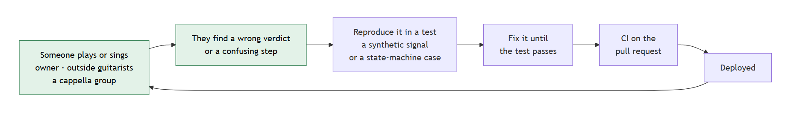
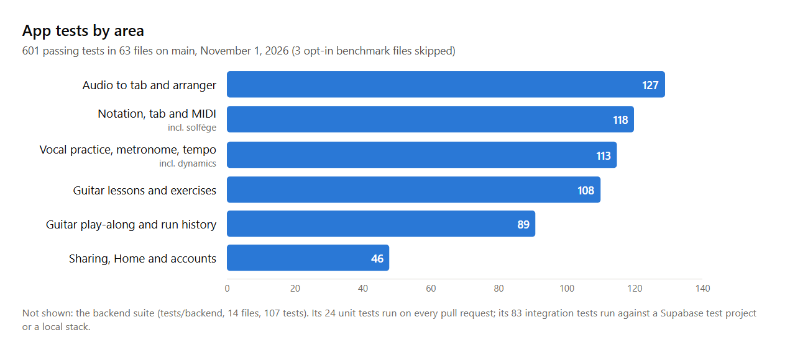
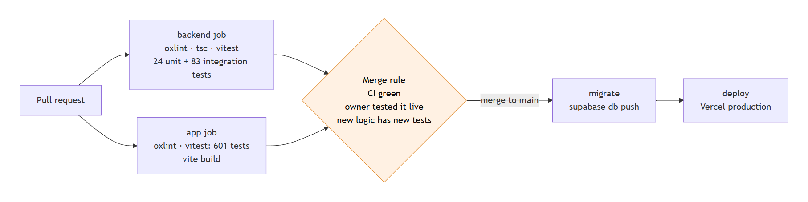

# Harmonic — Milestone 4: Test Plan

**Last Updated: Milestone 4 (Sunday, November 1, 2026)**

*This replaces the [M3 test plan](harmonic-test-plan.md). What changed: test counts re-run on `main` (Section 4.3); physical test cases for the features finished at M4 (guitar run history, sharing a run with its recording, solfège, dynamics) and for the open iPhone Safari check; the vocal cases now match the app (quiet singing is not scored, rather than answered with a message); and every case names the requirement it covers.*

---

## 1. Introduction

Harmonic's main job is to listen to a person singing or playing and judge what it hears. Whether that works can only be known with real voices, real guitars, real rooms and real devices. So most of Harmonic's testing is **physical**: people singing and playing into the app and telling us what it got right and wrong. Automated tests sit underneath. They run on every pull request and protect the logic that physical testing has already shaped.

This plan covers both: who tests the app physically and how (Section 3), what the automated tests cover and how CI runs them (Section 4), and when a change counts as tested (Section 5).

---

## 2. Testing Approach

| Method | What it tests | Who |
|---|---|---|
| Private testing by the team | Every feature, on our own instruments and devices, before it is merged | Each feature's owner |
| Guitar testing with other guitarists | Whether the Guitar tab hears real playing correctly and makes sense to a guitarist | Guitarists outside the team, organized by James |
| Vocal testing with an a cappella group | Whether the Vocal tab hears real singers correctly and helps them learn a part | Jamie's and Eduardo's a cappella group |
| Automated tests in CI | Scoring logic, audio analysis, notation, UI components and the backend, on every pull request | GitHub Actions |

Physical testing answers "does it work for a person?". Automated testing answers "did this change break something that already worked?". Neither replaces the other. A synthetic guitar signal can pass every unit test and still fail on a phone microphone in a noisy room, and a tester can't re-check 600 cases after every commit.

*Figure 2. How the two meet. Every problem found by a person becomes an automated test before it is fixed.*

---

## 3. Physical Testing

### 3.1 Private Testing by the Team

Before a feature is merged, its owner tests it on the running app with their own instrument or voice. Changes stay on a branch until that check is done. Each tester looks at what only a real microphone shows:

- Does the app hear the right note or chord, and only that?
- Does it reject wrong ones, including near misses?
- Does it ignore noise, such as typing, taps and the app's own metronome click?
- When the input is too quiet, does it avoid scoring a miss? (Guitar says "Couldn't hear you"; vocal leaves those moments unscored.)

Tests are run with and without headphones, on laptop and phone microphones, and on the deployed app as well as the local build. Features that save or share (run history, recordings, sending to friends) are tested signed in, with a second account as the friend.

### 3.2 Guitar: Testing with Other Guitarists

Other guitarists were asked to try the app and give feedback. Each tester was asked to:

1. Tune up with the Tuner and work through the first chord lessons in **Learn** (Guided, then Practice).
2. Play a built-in song in **Wait for me**, then in **Trouble spots**, with and without headphones.
3. Try **Strum on the beat** and a round of **ear training**.
4. Open a song file of their own, and try **Tab the guitar from a song** on a recording.

Feedback was collected on three questions: did the app agree with them about what they played, where did it get stuck or move on wrongly, and what was confusing.

Real playing found problems the unit tests had missed. Each became a fix with its own tests:

| What real playing showed | What changed |
|---|---|
| Wait for me moved on after wrong notes, copying the chord lessons' three-miss rule | Song Wait for me never moves on by itself: only the right note or Skip advances it |
| Typing or tapping near the microphone moved the cursor and even scored hits | A sound must be tonal, keep ringing and stand above the room's noise before it is judged |
| One strum counted twice, because the chord still rings into the next window | Onsets within 0.2 s are one gesture, and only freshly played notes count |
| Near-miss chords passed: E major for E minor, A7 for A | In Wait for me, every note of the chord must sound and nothing else, and the extra note is named |
| Strings still ringing from the last chord were counted as wrong | The judge checks which notes got louder at the strum |
| The microphone changing a lesson's chord on its own was confusing | Wrong strums are only counted, and the player moves on with a chord choice, Skip or Next |
| The metronome click came back through the speakers and was heard as a strum | Strum on the beat ignores sounds with almost no energy below 1.5 kHz |

**New at M4: testing the guitar run history.** Testing the run history (#44) on the deployed app, with two accounts, found four more problems:

| What testing showed | What changed |
|---|---|
| A friend who opened a shared run heard the song's MIDI, not the player; Wait for me runs had no recording at all | The shared view plays no MIDI, the player's recording comes first, and Wait for me records the run (#45) |
| The friend heard the recording, but the tab cursor stayed on the first note | Each run is saved with timing points, and the cursor follows the recording (#46) |
| A failed upload unticked "Keep recording", so runs were sent with no audio | Guitar runs always keep their recording; uploads are retried, then offered as Retry upload; sending waits for the upload (#47) |
| Every recording upload failed in Firefox with "NetworkError" | Recordings are sent as raw bytes, not wrapped in a form (#48). Case A5 confirms it. |

### 3.3 Vocals: Testing with an A Cappella Group

The vocal side is tested with Jamie's and Eduardo's a cappella group. Singers who learn parts every week are the audience the Vocal tab is built for, and they sing in the ranges and harmony the arranger writes for. Each singer is asked to:

1. Open a song, pick their own part, and listen with the metronome and tempo control.
2. Turn on **Do re mi** and check the syllables against how they learned the part.
3. Sing their part in **Wait for me** and **Trouble spots**, and record a run, including a passage sung louder and softer on purpose.
4. Look at the result on the score and in **This session**, and send an attempt to a friend.
5. Practise a part from an arrangement made by **Arrange a song for voices**.

Feedback covers the same three questions as for guitar, and also how useful the scores, the solfège and the practice history are for learning a part.

### 3.4 Physical Test Cases

These are the cases each round of physical testing works through. A case passes when the app's verdict agrees with the person playing or singing. **New** marks a case added for M4; **Changed** marks one reworded to match the app.

**Guitar**

| ID | Req | Feature | Steps | Expected result |
|---|---|---|---|---|
| G1 | F39 | Tuner | Pluck each string, out of tune and then in tune | The note and how far off it is; in tune within a few cents |
| G2 | F16, F34 | Chord lesson | Strum the lesson's chord cleanly | "Heard it", every string green |
| G3 | F16 | Chord lesson | Strum a chord one note off (E major for E minor) | Not accepted; the wrong strings marked red |
| G4 | F21 | Chord lesson | Play nothing, or very quietly | "Couldn't hear you", not a miss |
| G5 | F13 | Wait for me | Play a song's chords in order, letting strings ring | Each chord passes once; ringing strings aren't counted again |
| G6 | N6 | Wait for me | Type and tap near the microphone | No verdict, and the cursor doesn't move |
| G7 | F14, F24 | Trouble spots | Play along with headphones, making a few deliberate mistakes | The mistakes, and only those, marked amber or red; Loop bar offers the first miss |
| G8 | N1 | Latency calibration | Calibrate, then play Trouble spots through speakers | Notes played in time are credited to the right beat |
| G9 | F37, F40 | Metronome and tempo | Play at 50% with the click on | Clicks never scored as notes; the song slows with its tab cursor |
| G10 | F45 | Full / Easy | Switch a song to Easy | Only the first note of each bar and chord changes are scored |
| G11 | F18 | Strum on the beat | Strum early, on time and late on purpose | Each strum rated as played |
| G12 | F41 | Ear training | Answer a round of 10 | Right and wrong answers marked; missed chords replayable |
| G13 | F10 | Generated tab | Open a MIDI or MusicXML file without tab | Playable tab, with a notice saying it was generated |
| G14 | — | Audio to tab | Transcribe a recording with a guitar | A draft tab under My transcriptions that opens like a song |
| G15 | F1 | Progress on the account | Clear a chord signed in, then sign in on another device | The chord is shown cleared there too |
| G16 | F22 | **New.** Run history | Signed in, play a full Wait for me run, then a run stopped halfway | Both appear in Guitar → Practice sessions; "Last run · best" counts only the full run |
| G17 | F22 | **New.** Last and best by mode | Play full runs in Wait for me and in Trouble spots | Each mode's line shows only its own runs |
| G18 | F33 | **New.** Re-check | After a Trouble spots run, run the note-by-note re-check | The marks and the saved score both update |
| G19 | F22, F23 | **New.** Sharing a run | Send a run to a second account; open it there | The friend hears the player's recording (no MIDI), sees the same marks, and the cursor follows the recording |
| G20 | F23 | **New.** Upload that fails | Go offline at the end of a run, then come back | "Retry upload" appears and works; Send to friends waits for the recording |

**Vocals**

| ID | Req | Feature | Steps | Expected result |
|---|---|---|---|---|
| V1 | F4, F5, F9 | Open a song | Open a built-in, a catalog and an uploaded file | Sheet music with the part picker and playback |
| V2 | F37 | Playback | Play a part at 70% with the metronome | Notes, cursor and clicks slow down together |
| V3 | F13 | Wait for me | Sing each highlighted note, some slowly | The song waits; slow notes are called out in amber |
| V4 | F11, F14 | Trouble spots | Sing along, some notes flat or sharp | Notes within tolerance green, half a step off amber, misses red, with a summary |
| V5 | F21 | **Changed.** Quiet input | Stop singing partway through | The silent stretch is not scored: no run of red misses, and the score counts only what was sung |
| V6 | F22, F23 | Recorded attempt | Record a run signed in, with Keep recording on | The attempt appears under This session with its score and recording |
| V7 | F37 | Slowed attempt | Record at 70% tempo | It scores against the written rhythm, like one at full speed |
| V8 | F22 | Sharing | Send an attempt to a friend | It appears on their Home, redrawn on their copy of the song |
| V9 | F42 | Arranger | Arrange an audio file for voices | A multi-part score that opens, plays and can be practised |
| V10 | F15 | **New.** Solfège | Turn on Do re mi for a major song, a minor song and a MIDI file with no key signature | Movable-do syllables under every note; the minor song starts on la; the MIDI file's do is worked out from its notes |
| V11 | F15 | **New.** Solfège stays local | Export or share with Do re mi on | Exports and the shared attempt have no syllables |
| V12 | F19 | **New.** Dynamics | Record an attempt, swelling and fading on purpose | The meter shows ↗ louder and ↘ softer as you sing; the result counts the crescendos and diminuendos |
| V13 | F19 | **New.** Even volume | Record an attempt at one steady volume | "An even volume throughout", with no swells counted |

**Across the app**

| ID | Req | Feature | Steps | Expected result |
|---|---|---|---|---|
| A1 | F1 | Sign-in | Sign in and out | Progress, attempts, runs and friends follow the account |
| A2 | N2 | Phone layout | Use each tab on a phone-sized screen | Everything fits from 360 px wide, nothing scrolls sideways |
| A3 | N4 | Installable app | Install the PWA and reopen it offline | It opens, and built-in songs and lessons work |
| A4 | N2 | **New.** iPhone Safari | On a real iPhone in Safari: tune a string, record a vocal attempt, play a guitar Wait for me run | Each works after a tap starts the audio; the result is written in Section 6 |
| A5 | F23 | **New.** Browsers | Finish and send a guitar run in Chrome, Firefox and Safari | The recording uploads and plays for the friend in each |

---

## 4. Automated Testing

### 4.1 What the Tests Cover

- **Scoring and practice logic.** Every practice mode is a pure state machine (Wait for me, Trouble spots, the chord lessons, ear training, strum timing, practice sessions and run history), so it is tested in Node without a browser.
- **Audio analysis on synthetic signals.** The guitar tests generate realistic strings in code, with stretched overtones, a pick-noise burst and ringing, plus keyboard clicks and room noise. With these, the note judge, onset detection and noise gate are tested against known answers. The voice's pitch detector and the new dynamics tracker are tested the same way.
- **Notation.** Loading MIDI, MusicXML and Guitar Pro files, converting to MusicXML, tempo marks, fret assignment, tidying MIDI, and solfège.
- **UI components.** Component tests run in jsdom with Testing Library.
- **Backend.** The `src/lib` layer is tested against Supabase, including row-level security: one user cannot read another's attempts, notes or progress.
- **Benchmarks (opt-in).** Audio to tab is scored against synthetic songs and a synthetic band. These run on request, not in CI, because they need the large models.

*Figure 4.1. Where the 601 app tests are.*

**Tests added for M4:**

| Test file | Tests | What it checks |
|---|---|---|
| `app/tests/solfege.test.js` | 20 | Movable do in major and minor keys, raised and lowered syllables, chords and ties, the key worked out for MIDI files |
| `app/tests/dynamics.test.js` | 13 | Level in dB, the louder / softer / steady trend, the level curve, phrases, and counting swells and fades |
| `app/tests/runHistory.test.js` | 9 | What counts as a full run, Wait for me verdicts and score, the last and best line |
| `app/tests/recordingTiming.test.js` | 8 | Timing points for Trouble spots and Wait for me, reading them back while the recording plays, pauses and seeks |
| `tests/backend/guitarRuns.test.ts` | 5 | Saving a guitar run with its mode, Easy and full-run flags; listing only comparable full runs; correcting a run after the re-check (nobody else can); the recording timing a friend reads; sessions listed per instrument |

### 4.2 The CI Pipeline

Every pull request and every push to `main` runs the pipeline on GitHub Actions (`.github/workflows/ci.yml`):

*Figure 4.2. The pipeline. The merge rule (Section 5) is checked by the reviewer; everything else is automatic.*

| Job | Runs | When |
|---|---|---|
| `backend` | Lint, typecheck and tests for `src/lib` and the migrations | Every pull request and push to `main` |
| `app` | Lint, unit and component tests, production build | Every pull request and push to `main` |
| `migrate` | Applies new database migrations to the live Supabase project | Push to `main`, only after `backend` and `app` pass |
| `deploy` | Deploys the app to Vercel production | Push to `main`, only after `migrate` succeeds |

A change that fails a test, the lint or the build cannot reach users: the deploy waits on the tests and the migration. The backend's integration tests run when the Supabase test secrets are configured and skip themselves otherwise; the team also runs them against a local Supabase stack.

### 4.3 Current Numbers

Re-run on `main` (commit `2685822`) on November 1, 2026:

| Suite | Test files | Result |
|---|---|---|
| App (`app/tests`) | 66 | **601 tests pass** in 63 files; 3 opt-in benchmark files (6 tests) skipped by default |
| Backend (`tests/backend`) | 14 | **107 tests**: 24 unit tests pass on every run; 83 integration tests run against a Supabase test project or local stack, and skip without its keys |

At M3 the app had 62 test files and 551 tests, and the backend 13 files.

---

## 5. When a Change Counts as Tested

A pull request is merged when:

1. **CI passes:** lint, typecheck, all automated tests and the production build.
2. **Its owner has tested it physically** on the running app with their instrument or voice, covering the physical test cases for the feature it changes (Section 3.4).
3. **New logic has new tests.** A bug found in physical testing gets a test that reproduces it before it is fixed, as with the fixes in Section 3.2.

Changes that most affect how the app hears people, such as the guitar judge or the vocal scoring tolerances, also go back to the outside testers in the next round.

---

## 6. Known Limits and Next Steps

- **iPhone Safari (N2) is not yet tested.** Case A4 is the plan: one full pass on a real iPhone before the final demo, with the result recorded here.
- **Recording uploads in Firefox.** The fix in #48 needs case A5 run in Firefox to confirm it.
- **Synthetic signals are not real instruments.** The guitar judge's thresholds were first set on simulated strings and are being tuned on real recordings from the guitar testers.
- **No automated end-to-end microphone tests.** CI never plays audio into a browser. That path is covered by physical testing only.
- **Audio to tab has no accuracy measure on real songs,** because there are no reference tabs to score it against. It is marked experimental in the app.
- **Feedback is gathered informally,** in conversation and messages rather than a survey, so it shows what people found but not how often.
- **Next:** harden the tests around sharing and recordings, where M4's bugs were found, and tune the guitar judge on real recordings.
