# Design Document for Harmonic — Milestone 5

**Last Updated: Milestone 5 (Thursday, November 12, 2026)**

*This document describes the **Vocal tab's visual and interaction redesign**, made after M4 review feedback that the app "looks like a prototype". It covers only the Vocal tab: the Guitar tab is being redesigned separately by teammates and is unchanged here. Everything else in the [M4 design document](M4-design-document.md) (the stack, the schema, listening on the device, the arranger) still holds, and this document follows its section numbering where it can. Feature status is in [M4 implementation of planned features](M4-implementation-of-planned-features.md) and testing in the [M4 test plan](M4-test-plan.md). The work is on the `feat/ui-polish` branch.*

### Changes since Milestone 4 at a glance

| Area | At M4 (Nov 2) | At M5 (Nov 12) |
|---|---|---|
| Look | Plain grey and teal, colours written into each CSS file, mostly light mode only | One **design system** for the tab: shared colour, spacing, shape and motion tokens, with a full dark mode (Section 2.1) |
| Section bar | Grey capsule of five text tabs | Icon tabs, each section in its **own colour**; "Exercises" renamed **Practice**; a 🔥 **streak** counter and a 🔊 **sound** switch (Section 2.2) |
| Songs home | A long list of song names | A hero, two quick cards, a **grid of colourful song cards** and a dashed "upload your own" card (Section 2.3) |
| Song screen | Up to ten controls stacked down the page | **Three mode cards**, a ⚙️ **Settings sheet** for part, accompaniment, solfège, metronome and tempo, a ⋯ **menu** for export and sessions, and a **sticky player** (Section 2.4) |
| Learn | A Solfège / Rhythm switch | A **lesson path** in two units: lessons unlock in order and show the best stars (Section 2.5) |
| Answer feedback | Text and a red flash | **Pop, shake, sounds**, a progress bar, "🔥 3 in a row!" and an **end-of-lesson celebration** with stars (Section 3) |
| Practice, Warm Up, Compose | Long paragraphs above the controls | Short intros with a "How it works" drop-down; best stars on tests; a round counter and a finish screen for Warm Up; numbered steps for Compose (Sections 2.6–2.8) |
| Sound | None outside the music | Six short **synthesised sound effects** with vibration on phones; mute remembered (Section 3.1) |
| Progress | Nothing kept | A **daily streak** and **best stars** per activity, kept on the device (Section 3.3) |
| Code | n/a | New `theme/`, `ui/` and `feedback/` folders in `src/tabs/vocal/`; 30 files changed; 1 new test file (Section 4) |

---

## 1. Introduction

At the M4 review we were told that Harmonic works but looks unfinished: the Vocal tab in particular read as "a crazy conglomeration of features". Each feature had been added where there was room, so the song screen stacked up to ten controls, every screen opened with a long paragraph, and a right or wrong answer looked the same as everything else on the page.

The goal of M5 was to make the Vocal tab **look and feel like a finished product without removing anything it can do**. We used Duolingo as the reference, since it is a well-known learning app that a lot of people find pleasant to use:

1. **One clear next step per screen.** Rarely used settings are tucked away, and the main action is the biggest thing on screen.
2. **Bold, friendly visuals.** Strong colour, chunky buttons that press down, rounded cards, and a colour for each section.
3. **Instant feedback.** Every answer has a sound, a movement and a colour, and every finished activity ends with a reward.
4. **A reason to come back.** A daily streak and stars to beat.

The redesign is a visual and feedback pass. Scoring, listening, playback, saving and sharing are unchanged, and all existing tests pass without edits.

---

## 2. User Interface

### 2.1 Design

Everything new lives under the `.vocal-frame` element that wraps the Vocal tab, so the Guitar tab and the rest of the app are not affected.

**Tokens.** `theme/vocalTheme.css` defines every colour, size and timing once, as CSS custom properties (`--v-*`). The component styles use these tokens, so the whole tab changes together, and dark mode is a second set of values rather than a second set of styles.

| Token group | Values |
|---|---|
| Brand | `--v-primary` teal `#12999b`, with a darker "lip" `#0b7577` for the 3D buttons |
| Meaning | good green `#46a302`, bad coral `#e5484d`, gold `#ffb800` (stars and streak), sky `#1c9ce6` |
| Section accents | Songs teal, **Learn** purple `#8b5cf6`, **Practice** sky `#1c9ce6`, **Compose** orange `#f97316`, **Warm Up** pink `#ec4899` |
| Surfaces | background, card, subtle, border, text and muted, each with a dark-mode value |
| Shape | radius 8 / 12 / 16 px and pill; a 4 px button lip |
| Spacing | 4, 8, 12, 16, 24, 32 px (`--v-s1` to `--v-s6`) |
| Type | headings in a rounded system font (`ui-rounded`, SF Pro Rounded, Nunito, then the normal stack), weight 800 |
| Motion | 120 / 220 / 400 ms, an ease-out curve and a slight overshoot ("bounce") curve |

Each section sets `--v-accent` to its own colour (`.vocal-frame--learn`, `--compose`, and so on). Buttons, progress bars, headers and highlights all use `--v-accent`, so a Learn button is purple and a Warm Up button is pink without any extra rules.

**Shared building blocks.** One button (`.v-btn`, with secondary, ghost, good and danger variants and three sizes), one card (`.v-card`, optionally pressable) and one chip are used across all five sections. Buttons and pressable cards have a coloured lip underneath that disappears as they move down 4 px when pressed. This is the "physical" feel Duolingo is known for.

**Motion.** `theme/motion.css` holds the animations: pop, shake, rise-in, slide-up, float-up, a pulsing ring, breathing, confetti and a shine. Each section fades and slides in when opened, and lists come in one card after another. With the system's **reduce motion** setting on, all of it is cut to an instant change.

### 2.2 The Vocal Frame

The section bar at the top is now a row of **icon tabs**: 🎵 Songs, 📖 Learn, 🎯 Practice, ✍️ Compose, 🔥 Warm Up. Inactive tabs are grey. The open tab is filled with its section's colour, and its icon grows slightly with a bounce. "Exercises" is now **Practice**, which says better what it is for; the section's internal id is unchanged, so links and saved state still work.

On the right are three controls:

- **The streak** (🔥 4). The count of days in a row with something finished. It stays grey until the singer finishes something today, then lights up gold with a pop.
- **The sound switch** (🔊 / 🔇). Turns the sound effects on or off, for every screen, and is remembered in the browser.
- **The account chip**, as before.

On phones (480 px and narrower), all five tabs show just their icon, and the open one stays coloured. If they still don't fit, the tab row scrolls sideways instead of running under the streak.

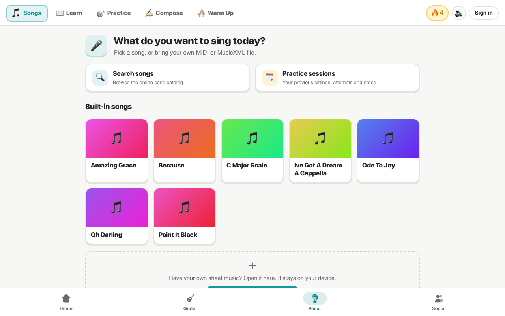

*Figure 2.1. The new Vocal frame and Songs home. Compare the M4 layout in [Figure 2.1 of the M4 document](images/m4-vocal-sections.png).*

### 2.3 Songs Home

The Songs home used to be a column of identical rows. It now reads from top to bottom as "what to do here":

1. **A hero**: "What do you want to sing today?", with a short line about bringing your own file.
2. **Two quick cards**: 🔍 Search songs (the online catalog) and 🗓 Practice sessions.
3. **Built-in songs as a grid of cards.** Each card has a **gradient cover** whose colour comes from a hash of the song's title. The same song therefore always has the same colour, and no artwork has to be stored.
4. **A dashed "＋" card** at the end for opening your own MIDI or MusicXML file.

### 2.4 The Song Screen

This was the screen the feedback was mostly about. At M4 it showed, top to bottom: the toolbar with two export buttons, the arrangement note, the part tabs, the score, the practice-mode switch, accompaniment, lyrics/solfège, the metronome, tempo, the player and the record panel. Nothing has been removed, but it is now grouped by how often it is used.

- **Toolbar.** "← Songs", the song's name and file type, and a **⋯ menu** holding Export MusicXML, Export MIDI and, when signed in, Practice sessions.
- **Three mode cards.** 🎧 **Listen** (play along, then record), ⏸️ **Wait for me** (it waits for your note) and 🎯 **Trouble spots** (find the hard bits). These replace a small three-way switch. The chosen card takes the section colour and shows a one-line hint underneath.
- **⚙️ Settings** opens a **sheet** that slides up from the bottom of the screen. It holds **Your part**, **Practise with** (by myself / with all parts), **Under the notes** (lyrics / solfège) and **Metronome & tempo**. Next to the button, a summary line shows what is set, for example "Solo Line 1 · By myself · Lyrics · 100% tempo", so the singer doesn't have to open the sheet to check.
- **The score**, in a white card. It stays white in dark mode so the black notes remain readable.
- **The player.** In Listen mode Play, Stop and the seek bar are **pinned to the bottom** of the screen while the score scrolls. Wait for me and Trouble spots keep their own controls in the same place.
- **Record attempt**, in a card of its own. The red button pulses while the microphone is listening.
- **The arrangement note** for arranged songs ("✨ Arranged for…") is now a single line that opens when tapped, not a paragraph.

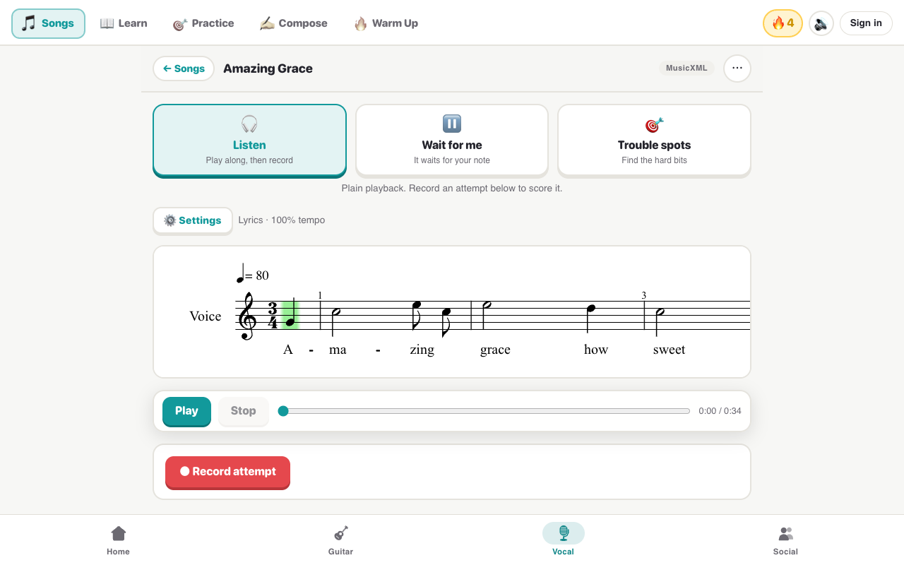

*Figure 2.2. The song screen. Compare the M4 layout in [Figure 2.6 of the M4 document](images/m4-vocal-solfege-song.png), where every control was stacked on the page.*

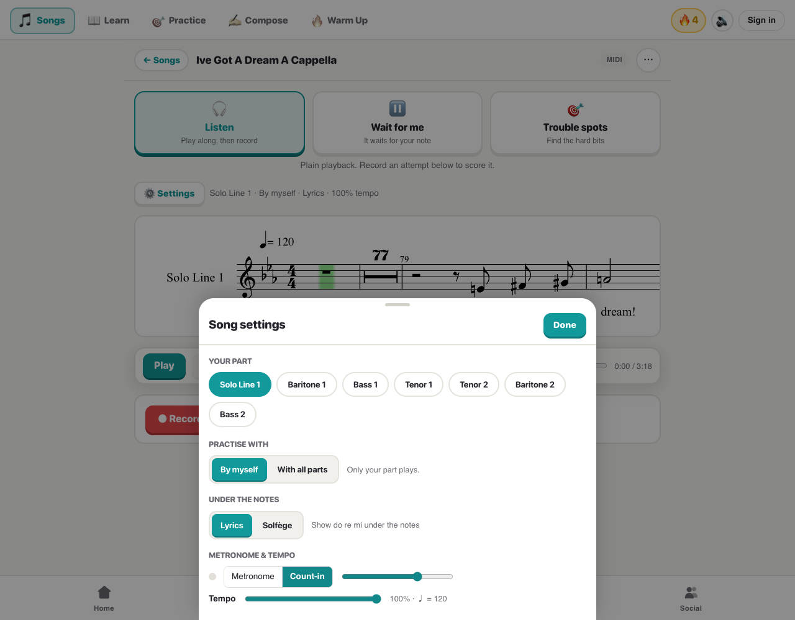

*Figure 2.3. The Settings sheet: the five rows that used to sit on the page.*

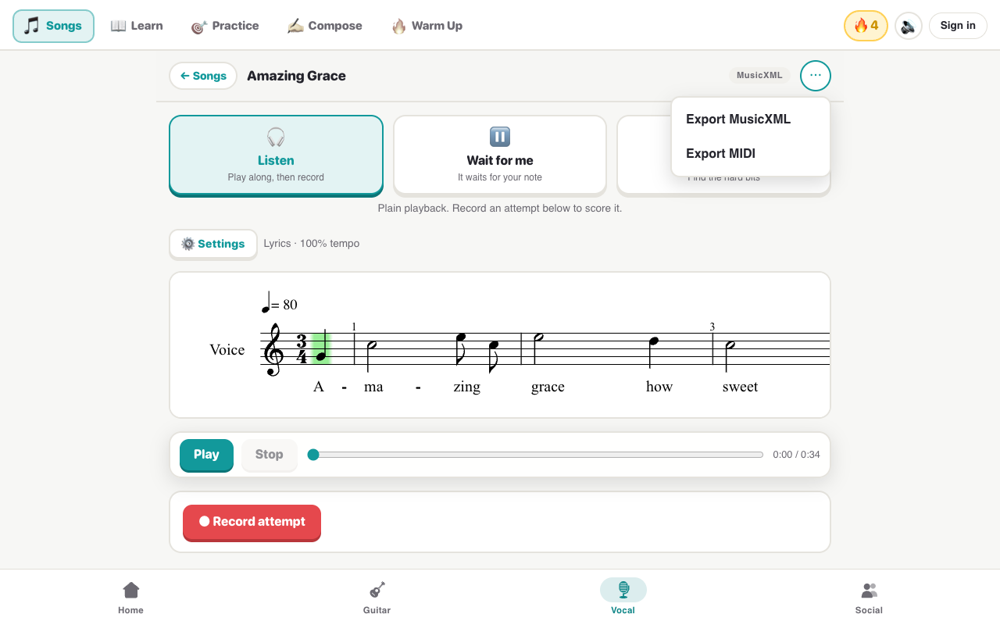

*Figure 2.4. Export (and Practice sessions, when signed in) moved into the ⋯ menu.*

The sheet is drawn at the top level of the page (a React portal) inside its own themed wrapper. Inside the tab's scrolling area, the slide-in animation would have trapped it underneath the bottom navigation bar. It closes with Done, by tapping outside it, or with Escape.

### 2.5 Learn: a Lesson Path

At M4, Learn had a Solfège / Rhythm switch, with every exercise on one long page. It is now a **path of lessons** in two units, each with a coloured banner:

| Unit | Lesson | What it is |
|---|---|---|
| 1. Solfège | 🎼 The scale | The C major scale with its do re mi boxes; play it or tap a box |
| | 👀 Read it | Name the notes of a short melody on the staff |
| | 👂 Hear it | Name the notes of a short melody you hear |
| 2. Rhythm | 👏 Clap along | Quarter, half, whole and eighth notes to a click |

Each lesson is a round button on a path that sways left and right. It is in one of three states:

- **Done**: gold, with the best stars underneath.
- **Current**: the section colour, with a pulsing ring and a "START" bubble.
- **Locked**: grey with a 🔒.

A lesson unlocks once the one before it has been finished once. The lesson content and its rules (`learnLogic.js`) have not changed. Inside a lesson there is "← Lessons" to go back, and "Next: … →" once the next lesson is open.

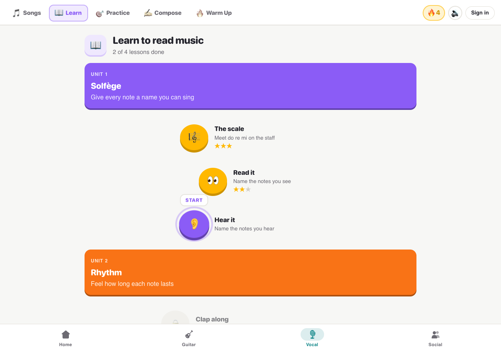

*Figure 2.5. The Learn path: two lessons done, the third ready to start.*

In a quiz, the answer boxes are chunky pressable buttons, and each answer gets instant feedback (Section 3.2). A progress bar fills as notes are named, and "🔥 3 in a row!" appears at 3, 5, 10, 15 and 20 right answers in a row. The quiz ends with a **celebration**: 0 to 3 stars, a headline, the score, a burst of confetti and the next step.

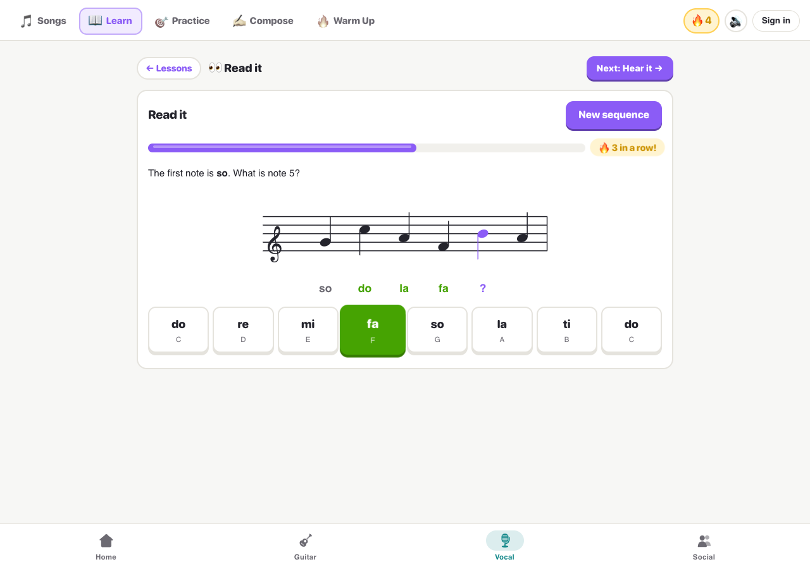

*Figure 2.6. Read it, mid-quiz: a right answer turns green and pops, the progress bar moves on, and three in a row earns a badge.*

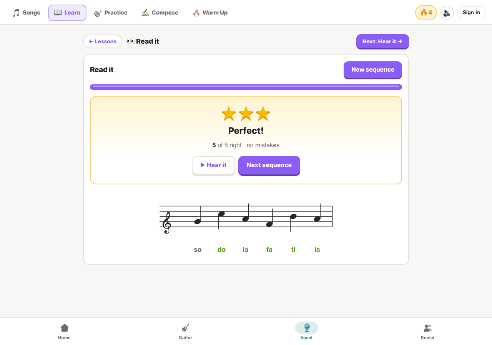

*Figure 2.7. The end-of-lesson celebration.*

### 2.6 Practice (was Exercises)

The pitch and harmony tests are big pressable cards, each with an icon, a one-line description for the chosen voice part and the **best stars** so far. The voice part buttons use the same pressable style, filled in the section's sky blue. While a test runs, its instructions sit in a "How it works" drop-down rather than above the controls. When it finishes, it ends with the same celebration as Learn ("3 of 4 right", with stars).

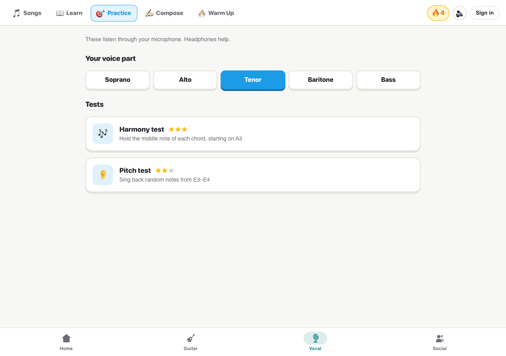

*Figure 2.8. Practice, with the best stars for each test.*

### 2.7 Warm Up

The explanation is now one sentence plus a "How it works" drop-down. Voice parts and the two exercises (↑ upper range, ↓ lower range) are pressable cards in pink. While it plays, a large card shows the **Sing / Listen** cue, the next starting note, and a **progress bar of rounds** ("Starting note · 3 of 17"), so the singer can see how far through their range they are. Reaching the end of the range shows a "Warm-up complete! 🔥" finish screen with confetti and a line saying how far they went ("17 rounds, D3 to F#4…").

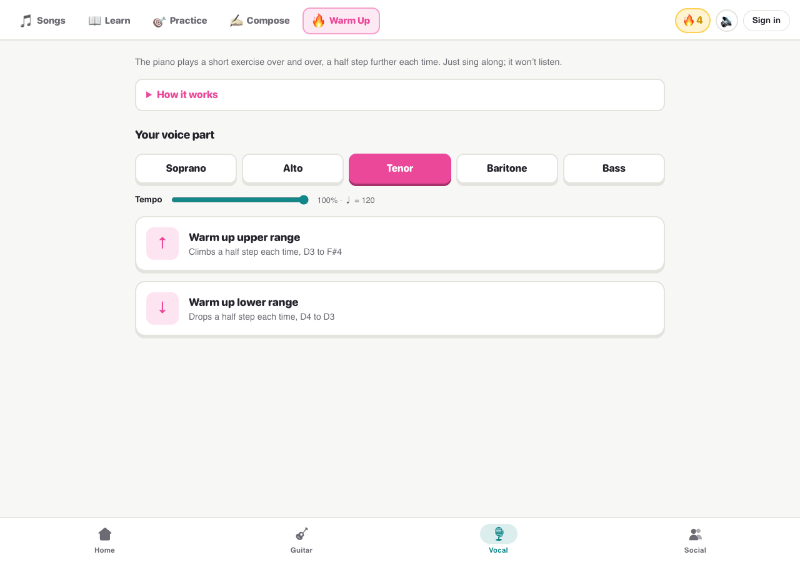

*Figure 2.9a. Warm Up, choosing an exercise.*

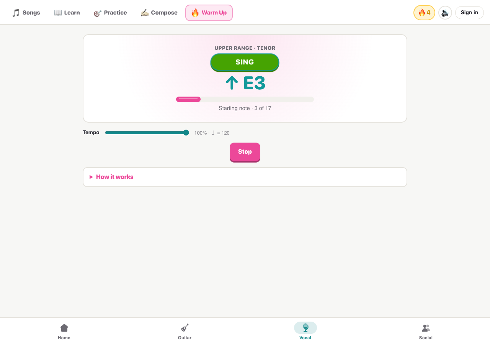

*Figure 2.9b. Warm Up under way, with the round counter.*

### 2.8 Compose

The vocal arranger reads as three numbered steps, each in its own card: **1 Which song?** (the YouTube link), **2 Who's singing?** (voices and the keep-key option) and **3 Arrange it** (choose the audio). The long description moved into "How it works". While the arranger runs, the old thin bar is replaced by a centred card with the shared progress bar and the current stage.

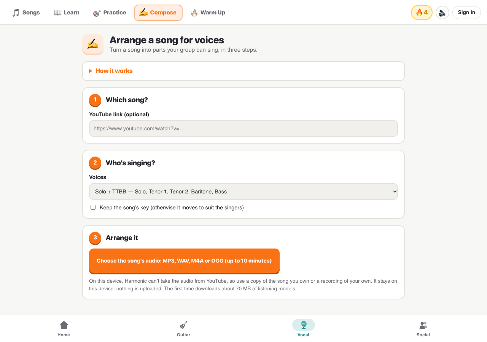

*Figure 2.10. Compose as three numbered steps.*

### 2.9 Phones and Dark Mode

Everything above was checked at phone width and in dark mode. The tokens switch with the system's dark setting. Cards become dark grey, accents get lighter so they stay readable, and the score keeps its white card.

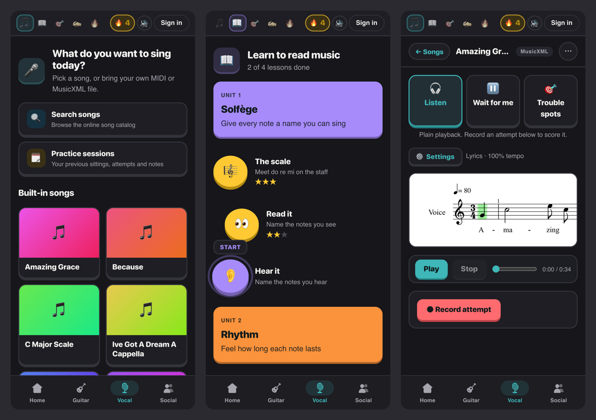

*Figure 2.11. Songs, Learn and a song on a phone (390 px wide) in dark mode.*

---

## 3. Feedback, Sound and Progress

### 3.1 Sound Effects

`feedback/sfx.js` makes six short sounds with Tone.js, which the app already uses for playback. They are synthesised when needed, so no audio files are shipped. They are played on a soft, bell-like synth at -14 dB, quieter than the music.

| Sound | When | What it is | Phone vibration |
|---|---|---|---|
| `tap` | Opening a lesson, switching practice mode | One very short high C | — |
| `correct` | A right answer | A quick rising third (E5 → G#5) | — |
| `wrong` | A wrong answer | A soft low bump (A2 → G#2) | 60 ms |
| `streak` | 3, 5, 10, 15, 20 in a row | A fast C–E–G run | — |
| `complete` | Finishing a lesson, test, warm-up, Wait for me / Trouble spots run, or recorded attempt | A four-note rising arpeggio | short double |
| `perfect` | Finishing with 3 stars (or a Wait for me / Trouble spots run scoring 90+) | The arpeggio plus a sparkle an octave up | longer pattern |

The 🔊 switch in the top bar mutes them all. The setting is stored as `harmonic.vocal.sfx` and shared through a tiny store (`useSfxMuted()`), so every screen updates at once. Sounds play only on taps and after the last note has been scored. They never play while the microphone is still judging, so they can't be picked up as singing. If audio can't start (for example in tests, or before the first tap), the feedback is simply visual only.

### 3.2 Answer Feedback and Animation

| Moment | What the singer sees and hears |
|---|---|
| Right answer | The box turns green and **pops** (scales up and back), with the `correct` sound |
| Wrong answer | The box turns coral and **shakes** side to side, with the `wrong` sound; the run of right answers resets |
| Several in a row | A gold "🔥 *n* in a row!" badge pops in, with the `streak` sound |
| Progress | A thick rounded bar with a shine fills with a bounce |
| Finished | The **celebration**: stars pop in one by one, a headline, the score, confetti for two stars or more, and the next step |
| Recording | The record button pulses while listening |

The celebration (`ui/Celebration.jsx`) is the same everywhere. Stars come from the share right: **3** for everything right, **2** for 70% or more, **1** for 40% or more, and **0** below that. The headline follows: "Keep going!", "Good start!", "Great job!" or "Perfect!". Warm Up has no score, so it shows a trophy and its own headline instead of stars. For two stars or more, confetti bursts out: 36 small CSS shapes with their own colours, angles and delays. No animation library was added.

### 3.3 Streak and Stars

`feedback/progress.js` keeps a small record in the browser under `harmonic.vocal.progress`:

```json
{ "streak": 4, "lastDay": "2026-11-12", "stars": { "solfege-scale": 3, "solfege-read": 2, "pitch-test": 2 } }
```

- **The streak** goes up by one the first time something is finished on a new day, if the last day was yesterday. It restarts at 1 after a missed day. The top bar shows 0 once a day has been missed, and the pill is lit only once something has been finished today. Days use the device's local date, and the tests cover the end of a month.
- **Stars** keep the **best** result for each activity. They are shown on the Learn path and the Practice cards, and they decide which lessons are unlocked.

This is deliberately **on the device only**. Nothing is added to the database or the account, so there are no migrations and no backend changes. Section 7 explains why.

---

## 4. Code Structure

All changes are inside `app/src/tabs/vocal/`, plus one test file. The redesign adds three folders:

| Folder | File | Purpose |
|---|---|---|
| `theme/` | `vocalTheme.css` | Tokens (light and dark), section accents, `.v-btn`, `.v-card`, `.v-chip` |
| | `motion.css` | Keyframes, the section entrance, the reduced-motion override |
| `feedback/` | `sfx.js`, `useSfx.js` | The six sounds, vibration, and the mute store and hook |
| | `progress.js`, `useProgress.js` | Streak and best stars in `localStorage`, and the hook |
| | `stars.js` | `starsFor(share right)` → 0–3 |
| `ui/` | `Celebration.jsx` | Stars or trophy, headline, score, confetti; plays the sound and records the result |
| | `ProgressBar.jsx` | The shared progress bar |
| | `useCombo.js` | Counts right answers in a row, flags 3/5/10/15/20 |
| | `BestStars.jsx` | The small star row on cards |
| | `ModeCards.jsx` | The three practice-mode cards |
| | `Sheet.jsx`, `Menu.jsx` | The slide-up settings sheet and the ⋯ menu |
| | `ui.css`, `songScreen.css` | Styles for the above, and the song screen layout |

The existing screens were then changed to use these files: `VocalTab.jsx` (frame, Songs home and song screen), `learn/VocalLearn.jsx` (the path), `learn/SolfegeLearn.jsx` and `RhythmLearn.jsx`, the three Warm Up screens, `ArrangePanel.jsx`, `RecordPanel.jsx`, `WaitModePlayer.jsx`, `TroubleSpotsPlayer.jsx` and `SongLibrary.jsx`. Every Vocal CSS file now uses the tokens instead of fixed colours.

**Keeping Guitar unchanged.** The Guitar tab reuses several Vocal components (the song library, player, practice sessions, sharing, the part tabs and practice-mode styles). Two rules keep it looking exactly as it did:

1. Shared component styles use the token **with the old colour as a fallback**, for example `var(--v-border, #e2dfd8)`. Inside the Vocal tab the token applies. In Guitar there is no token, so the old colour is used.
2. Vocal-only restyles of shared pieces are written as `.vocal-frame .part-tabs …`, so they apply only inside the Vocal tab.

Shared files outside the tab (`src/audio/`, `src/auth/`, `App.css`, `index.css`) were not edited.

---

## 5. Design Rationale

- **Group, don't remove.** Every M4 control is still one tap away. Part, accompaniment, solfège, metronome and tempo are usually set once per song, so they belong in a sheet. The practice mode is chosen every time, so it gets the biggest buttons.
- **One accent per section.** The colour tells the singer where they are before they read anything, and lets one set of components look different in each section.
- **Feedback that is felt, not read.** At M4 a wrong answer was a 450 ms red flash and a line of text. A shake and a low bump are understood immediately, even while looking at the staff.
- **Synthesised sounds.** Tone.js is already loaded, so six short sounds cost a few lines of code, no downloads and no licensing.
- **Progress on the device.** A streak and stars are motivation, not data that needs to follow the singer between devices. Keeping them local meant no schema change and nothing new to secure. Section 6 lists syncing them as a possible next step.
- **Respect the microphone.** Sounds wait until scoring is finished, so they can never be counted as singing.
- **Accessibility.** The reduced-motion setting is respected. Icon-only tabs keep their text labels for screen readers. Locked lessons, the streak and stars have spoken labels. The sheet closes with Escape. Colour is never the only signal: right and wrong answers also differ in movement and sound, and stars are counted in text.

---

## 6. Testing

- **Automated.** `npm run ci` (lint, type check, root and app tests, build) passes: 72 app test files (69 run, 3 opt-in benchmarks skipped), 627 tests passed and 6 skipped; the root suite 24 passed. The new `app/tests/vocalFeedback.test.js` has 7 tests: the star thresholds, mute being remembered, and the streak (extended on the next day, restarted after a gap, across a month end) and best stars (the best kept per activity, still there after a reload). The existing Vocal tests pass without changes, which confirms the scoring and listening behaviour is unchanged.
- **In the browser.** Every screen in this document was checked in Chrome on a desktop (1280 px, light mode) and at phone sizes (360 and 390 px, dark mode). The screenshots were taken on the running app. This check found that at 390 px the section tabs ran under the streak and "Sign in" was cut off, and both were fixed (Section 2.2). The Guitar tab was checked and looks as it did at M4.
- **Not yet checked by hand:** the Warm Up finish screen from a full run, and recorded attempts and practice runs with a real microphone. Those paths are covered by the existing automated tests, and the redesign only adds a sound and a streak update at their end.

---

## 7. Known Gaps and Next Steps

- **Streak and stars stay on one device.** Signing in on a new phone starts from zero. They could later be saved to the account with one small table.
- **New devices start at the first lesson.** Learn unlocks in order, so a demo on a fresh browser starts at "The scale" (one tap on Play to unlock the next). If this gets in the way, unlocking everything is a one-line change in `learn/VocalLearn.jsx`.
- **The metronome toggle** inside the Settings sheet keeps its own light styling in dark mode. It is a shared component in `src/audio/`, used by Guitar as well, so it was left for the shared redesign.
- **No per-answer "Nice! / Not quite" banner.** Duolingo shows a banner after every answer that must be dismissed. We used the pop, shake and sounds instead (Section 8).
- **Rhythm still doesn't listen,** so any complete play-through counts as done and earns 3 stars; it can't tell a good clap from a bad one.

---

## 8. Trade-offs

### 8.1 What we cut

| Planned | What we did | Why |
|---|---|---|
| A "Nice!" / "Not quite" banner sliding up after every answer, with a Continue button | Instant pop / shake, sound and the combo badge; one celebration at the end | A banner needs an extra tap per answer. In a six-note sight-reading run that doubled the taps and slowed the drill down. |
| A "Continue where you left off" card on the Songs home | Not built | The last session lives in the account's practice sessions, which aren't loaded on the home screen when signed out. Practice sessions is one tap away in the quick cards. |
| XP and levels | A streak and stars only | XP would need rules for every activity and a place to store it. A streak and stars get most of the motivation with none of the bookkeeping. |
| Restyling the shared metronome and tempo controls | Left as they are | They live outside the Vocal tab and are shared with Guitar, which teammates are redesigning. |

### 8.2 What we refused to cut

- **Every feature stays.** The redesign moved controls, never removed them. A singer who used a setting at M4 can still find it on the same screen.
- **The scoring is untouched.** No rule, threshold or state machine was changed to make the new feedback easier to build, and the existing tests prove it.
- **Guitar is untouched.** Shared components keep their old colours outside the Vocal tab, so the two redesigns can't clash.
- **Calm when asked.** Sounds can be muted, motion follows the system setting, and the sounds never play over the microphone.
