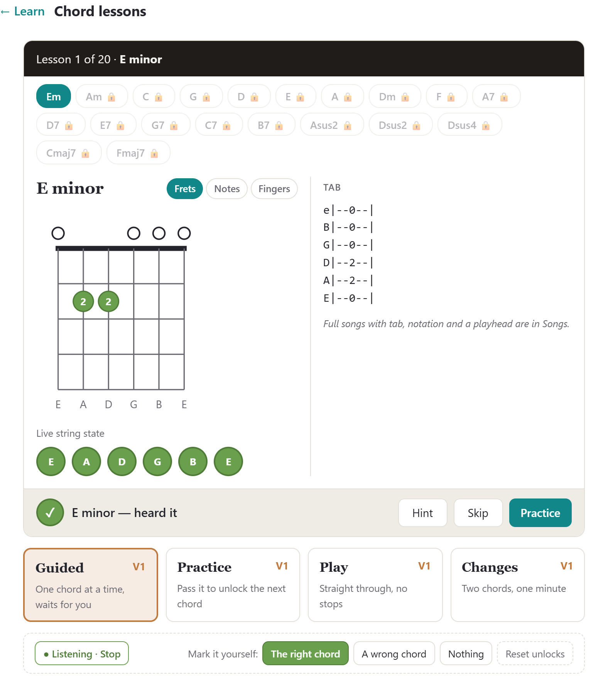
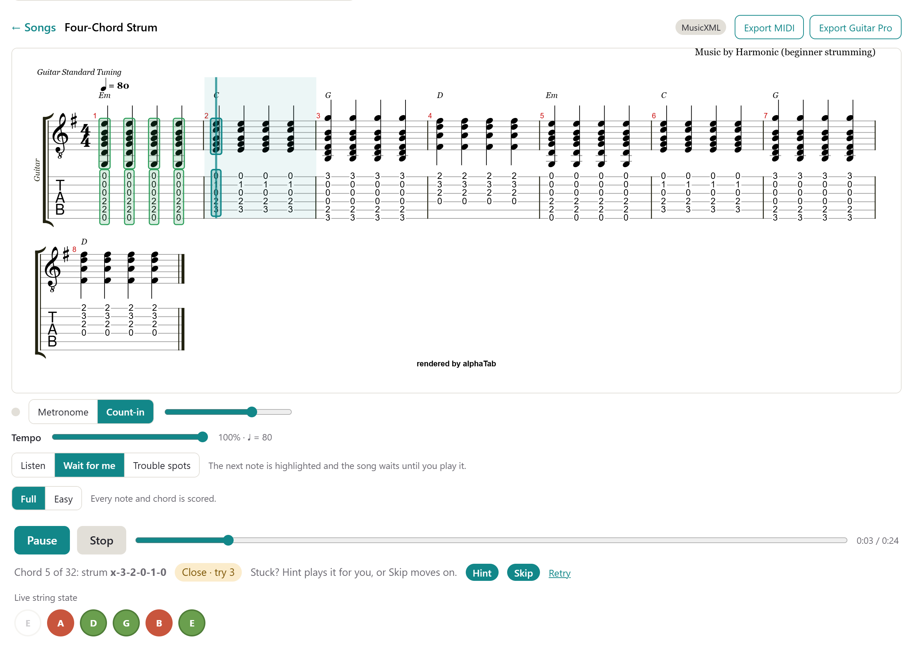
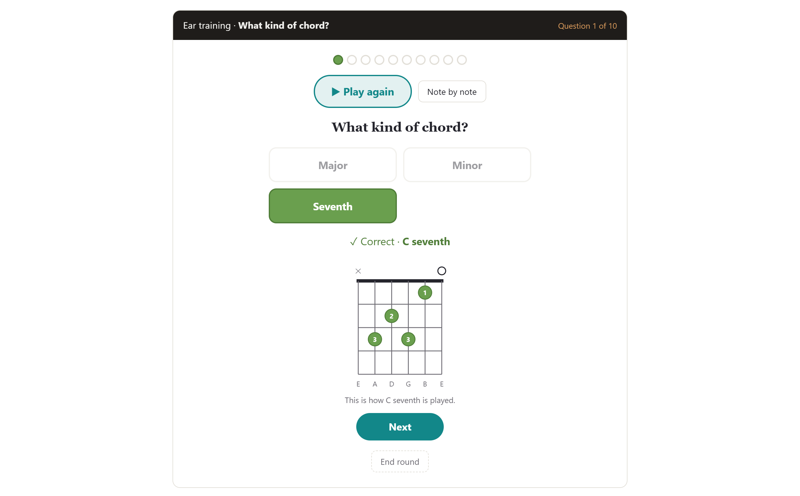
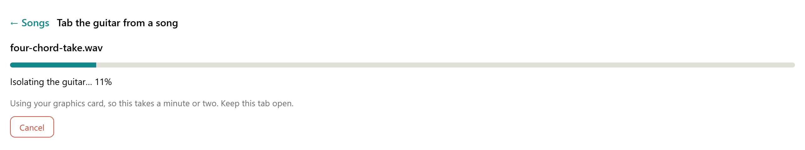
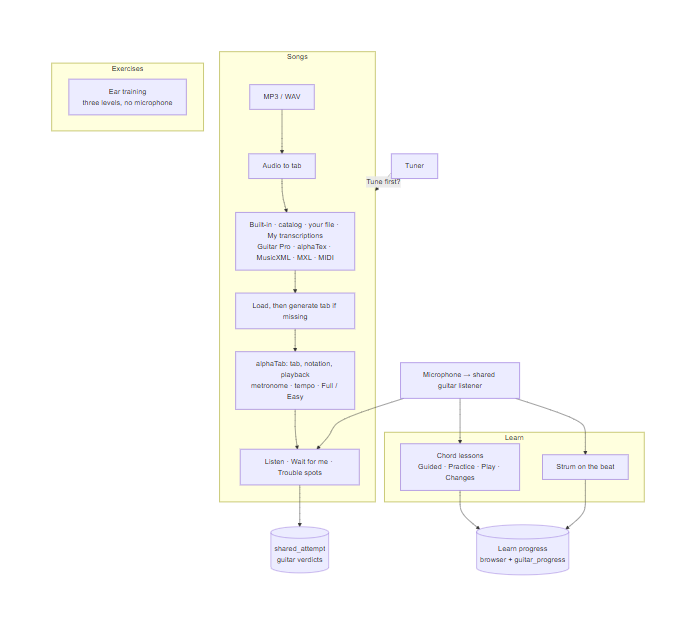
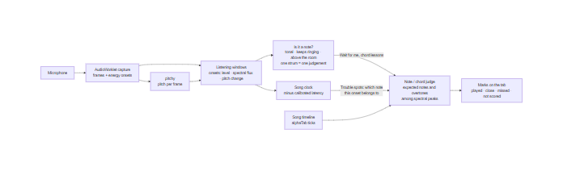
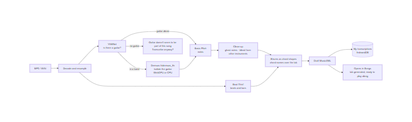
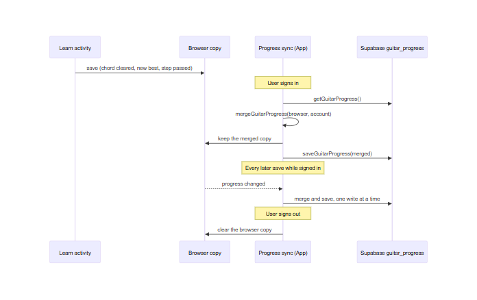

# Design Document for Harmonic: Guitar

**Last Updated: Milestone 3 (Wednesday, October 21, 2026)**

**Author: James Barrera**

---

This document covers only the guitar features James Barrera built between the Milestone 2 review (September 30, 2026) and Milestone 3. It follows the section numbers of the [M2 design document](harmonic-design-document.md), so each part can be read next to the design it extends. The rest of the team's M3 work (the vocal arranger, practice sessions, Home, Social and the Fretboard view) is described in [M3 changes since M2](M3-changes-since-M2.md).

| Feature | Pull request | Where in the app |
|---|---|---|
| Metronome and tempo control | #15 | Guitar → Songs, and the Vocal tab |
| Ear training | #16, #19 | Guitar → Exercises |
| Playing along: Wait for me and Trouble spots | #17, #19 | Guitar → Songs |
| Full / Easy versions and the "Tune first?" prompt | #19 | Guitar → Songs |
| Tab for any MIDI, MusicXML or MXL file | #20 | Guitar → Songs |
| Audio to tab (experimental) | #20 | Guitar → Songs → Tab the guitar from a song |
| Learn: chord lessons and strum on the beat | #18, #30 | Guitar → Learn |

---

## 1. Introduction

At M2, the Guitar tab could tune a guitar, check a single chord by ear, and display tab songs that played back but did not listen. Since M2, the guitar has become an instrument the user can practise songs on. When the user plays along to a tab, Harmonic listens through the microphone and marks every note or chord on the tab as played, close or missed. Harmonic can also write tab: for any notation file that lacks it, and, as an experimental draft, from an audio recording of a song.

Around the songs sit a **Learn** view (chord lessons and strumming in time), an **Exercises** view (ear training), and a metronome and tempo control shared with the Vocal tab.

All microphone analysis and transcription still run on the user's device. The only guitar data that reaches Supabase is a signed-in user's lesson progress and any attempt the user chooses to share.

---

## 2. User Interface

### 2.1 Design

The Guitar tab opens on Songs and has five views: **Songs · Learn · Exercises · Fretboard · Tuner**. (Fretboard is a teammate's work and isn't covered here.)

The thin-shell rule from M2 still holds. Each practice activity is a pure state machine that takes "what the microphone heard" and "what the user pressed" and returns a new state. The React components only own the timers, the microphone and the drawing. Because the state machines (`waitState`, `troubleTracker`, `practiceState`, `playState`, `practiceRunState`, `changesState`, `earTraining`, `strumTiming`) have no browser dependencies, they are unit-tested in Node without a guitar.

### 2.2 Guided Lessons: the Learn View

Guided lessons were shelved at M2. They return as **Guitar → Learn**, which opens on two activity cards. Each card shows how far the user has got.

**Chord lessons.** Twenty chords in teaching order: the open major and minor chords, a small F, six dominant sevenths, three suspended chords and two major sevenths. Each chord can be learned in four modes:

| Mode | What happens |
|---|---|
| Guided | One chord at a time. The app waits until it hears the chord. |
| Practice | The checkpoint. Strum the chord cleanly three times in a row, each within five seconds, to clear it and unlock the next chord. After three timed-out runs, **Unlock anyway** appears. This is the soft gate from M2: imperfect detection never walls a learner in. |
| Play | The chords go by every five seconds and the app never waits. A score is shown at the end. |
| Changes | One minute, two chords: count every change from one to the other. The user taps each change, the microphone counts alongside, and the best count for each chord pair is kept. A transition diagram shows what each finger does: stay down, slide along its string, or lift and move to another string. |

What the microphone hears never changes the lesson's chord. Wrong strums are counted, and each string lights green or red on the chord diagram. The user moves on by choosing a chord, **Skip** or **Next**. **Hint** plays the chord with a plucked-string sound and pulses the diagram's dots in the order the fingers go down. Barre chords draw the barre. When the input is too quiet to judge, the lesson says so instead of counting a miss. The lessons listen with the same rules as a song's Wait for me (Section 2.3), so a lesson and a song judge a chord the same way.

*Photo: Chord lesson, E minor heard*

**Strum on the beat.** Five steps: muted strums at 60 BPM, E minor at 60, 80 and 100 BPM, then down-up eighth notes at 70 BPM. After a four-beat count-in, four bars are scored. Each strum is rated early, on time (within 60 ms of the click) or late. A summary line describes the user's habit, for example "You rush by about 40 ms". The step passes at 80% on time. The microphone can't reliably tell a down-strum from an up-strum, so only timing is scored, and a strum lane shows the motion instead.

The drill ignores its own click coming back through the speakers. A strum puts most of its energy below 1.5 kHz, while the click is filtered noise with almost none there.

**Progress follows the account.** The chords cleared, the Changes bests and the strum steps passed are kept in the browser, so the lessons work signed out. When the user signs in, the browser's copy is merged with the account's copy (a pass beats a skip, and the higher best wins). Progress is then saved to the account on every change. Signing out clears the browser's copy, so the next person on that device starts fresh.

### 2.3 Live Practice Runs: Playing Along to a Song

Guitar → Songs opens a built-in song (Ode to Joy, Four-Chord Strum, House of the Rising Sun), a catalog song, or the user's own file, and alphaTab renders it as tab and notation. At M2, songs could only be played back. They now have the same three modes as the Vocal tab, worded for guitar:

| Mode | What happens |
|---|---|
| Listen | Plain playback, with tempo, metronome, count-in and loop. |
| Wait for me | The next note or chord is highlighted, and the song waits until the user plays it. |
| Trouble spots | The user plays along in time, and every note is marked. Misses are red. |

Two accompaniment options, **By myself** and **With all parts**, choose what else plays. While the microphone is judging, the user's own part never plays. Otherwise the microphone would hear the app playing exactly the right notes and credit them to the user.

**Wait for me.** The song never moves on by itself. Only the right note or chord, or **Skip**, advances it. Wrong tries are counted, and after three the screen points the user to Hint and Skip. Because the user can always strum again, judging here is strict:

- **Every note of a chord must sound, and nothing else.** A chord one note off is not accepted (A7 for A, Cmaj7 for C, E major for E minor), and the extra note is named. Each string lights green or red.
- **One strum, one judgement.** Onsets close together are treated as one gesture. A wrong verdict waits until the gesture is over, so the first half of a slow strum isn't called wrong.
- **Only fresh playing counts.** The expected notes must get louder at the strum, so strings still ringing from the last chord are not counted again.
- **Clicks, taps and typing are not notes.** Before any judgement, a sound must be tonal, keep ringing for 300 ms, and stand above the room's noise floor.

**Trouble spots.** Playback never waits. Each pick or strum the microphone hears is placed on the song's clock and matched to the note it belongs to: the note whose start is nearest, within a 0.2-second grace window. Once playback passes a note with nothing heard, that note is marked missed.

alphaTab plays on one audio clock and the microphone records on another, so a **latency calibration** plays eight clicks and measures the round trip from speaker to microphone. The median delay is saved and subtracted from every onset. While the user plays, the status line shows the note the microphone hears, or "Couldn't hear you — play a little louder".

**Full / Easy.** Each song has a Full and an Easy version, and the choice is remembered per song. Easy scores only the first note of each bar and every change of chord. The rest stay on the tab, greyed out, and are passed over. In Easy, Four-Chord Strum becomes one strum per chord, and an arpeggio becomes its bass notes.

**Metronome and tempo** (shared with the Vocal tab):

- **Metronome.** A click on every beat with the downbeat accented, an optional one-bar count-in, and a volume control. The settings are remembered on the device. The click is high-passed noise, so the pitch tracker never mistakes it for a note.
- **Tempo.** From 50% to 100% of the written tempo, in 5% steps, remembered per song by the file's fingerprint. The printed tempo mark shows the tempo actually being played.
- **How it works in each tab.** On guitar, both features use alphaSynth's own metronome and playback speed. On voice, the tempo scales Tone.js's Transport, and score time is read in Transport ticks, so a slowed attempt still scores against the written rhythm.

**"Tune first?"** A banner above Songs suggests tuning up once per session if the tuner hasn't been used. It comes back when the user's notes sit consistently out of tune, meaning the median of the last eight single notes is more than 25 cents off. It never blocks a run.

*Photo: Wait for me. The player strummed E minor where C was expected, so the song waits and points at Hint and Skip.*

### 2.4 Run-through Summaries

As M2 planned, every judged note is marked directly on the tab: a box over the note in green (played), amber (close), red (missed) or grey (not scored). A note is close when it is the right note in the wrong octave, a semitone off, or only part of the chord.

alphaTab doesn't expose an element for each note, and restyling a note re-renders the whole score, which is far too slow for live feedback. So the marks are drawn on a separate SVG layer, placed using alphaTab's note positions and redrawn after every render.

- **Wait for me** ends with counts of notes played on the first try, played after a retry, and passed with Skip.
- **Trouble spots** ends with a line such as "Hit 41 of 52 · 6 close · 5 missed". A **Loop bar N** button loops the first bar with a miss, and the run's recording can be downloaded.
- **After-the-run check.** Live judging hears each strum through a short window. After a Trouble spots run, the user can have the recording transcribed on the device by Spotify's Basic Pitch and judged again. With a full polyphonic transcription to look at, arpeggios and chords are judged note by note, and bends can be heard.
- **Sharing.** A signed-in user can share a Trouble spots run as a link. The share carries the verdict on every note, never the song itself. A friend who opens the link sees the same marks on their own copy of the song, with the score and the recording if it was included.

### 2.5 Exercises: Ear Training (new)

The app strums a chord and the user picks what they heard. No microphone is needed, so ear training works on any device. There are three levels:

1. **What kind of chord?** Major, minor or seventh: the chord's character.
2. **Which chord?** Name it among four choices, drawn from the chords the user picks to train. Chords the user keeps missing come up more often, and accuracy is shown for each chord.
3. **Chords from my song.** The same, using the chords of the last song opened in Songs.

The user can **Play again** as often as they like, or hear the chord **Note by note**. After each answer, the right chord's diagram links the sound to the shape. After a wrong answer, **Hear yours** plays the chord the user picked next to the right one. Rounds are ten questions and end with the missed chords, which can be heard again.

Chords play through a plucked-string synth (Tone.js `PluckSynth`, one voice per string) instead of a keyboard-like tone. The lessons' Hint uses the same sound. Accuracy and the chosen chords are kept in the browser.

*Photo: Ear training, "What kind of chord?"*

### 2.6 Tab from Any File and from a Recording (new)

**Generated tab.** MIDI files and most MusicXML have pitches but no strings or frets. Opening such a file in Guitar → Songs now produces tab for every pitched part:

- **Choosing frets.** A Viterbi search over the whole line chooses a string and fret for every note or chord. It keeps the hand's movement along the neck small, prefers open strings and low positions, and never stretches past four frets.
- **Real-world MusicXML.** Voices are joined, ties stay on their string, transposing instruments are fretted at the pitch that sounds, and two-staff parts are merged.
- **Fitting parts to the guitar.** A part that doesn't fit is moved by whole octaves, stray notes are folded onto the neck, and unplayable chords are reduced to their bass, their top note and what fits between.
- **Tidying MIDI.** MIDI made from a recording is tidied first, so notes that overlap or ring on are not delayed, dropped or struck twice.

A notice under the title says the tab was generated and lists what was changed. A file's own tab, percussion and drum tracks are left alone.

**Audio to tab (experimental).** Under **Tab the guitar from a song**, the user uploads an MP3 or WAV (up to 10 minutes and 100 MB) and Harmonic writes a draft tab of the guitar part. The draft contains only what the guitar plays, not the whole song squeezed onto a guitar.

Everything runs in the browser, and nothing is uploaded. A progress bar walks through the stages: reading the audio, listening for a guitar, isolating the guitar, listening for notes, finding the beat, and writing the tab. If the song seems to have no guitar, Harmonic says so and offers **Transcribe anyway**.

Drafts are kept on the device under **My transcriptions** and open like any other song, so the user can play along to them in Wait for me or Trouble spots. A notice says the notes, rhythm and fingering are a best guess.

*Photo: Audio to tab in progress*

---

## 3. Core Audience

### 3.1 Independent Learners

The Learn view gives beginners an ordered path. Chords unlock one at a time, strum on the beat builds timing from muted strums upward, and the soft gate (Unlock anyway, Skip) keeps imperfect detection from stopping them. Ear training is the instrument-free drill the M2 design called for: it teaches the learner to hear the difference between E major and E minor, so they can tell for themselves whether they played the right chord.

### 3.2 Stranded Intermediates

Intermediates can now practise any song they choose, not a fixed curriculum. A file without tab gets tab automatically, and a recording can become a draft tab. Trouble spots shows exactly where a run goes wrong, Loop bar drills that spot, and the after-the-run check gives a closer, note-by-note second opinion. A run can be shared with a friend or teacher as a link.

### 3.3 Returning Musicians

Tempo control and the Easy version let returning players start below full difficulty and work back up. Ear training rebuilds hearing, and Changes mode rebuilds the speed of the fretting hand. Because progress is kept on the account, a few minutes of practice on a phone and a few on a laptop add up.

---

## 4. Software Stack

### 4.1 Frontend Framework

React 19 + Vite PWA, alphaTab for guitar notation and playback, and the shared AudioWorklet capture with pitchy are unchanged from M2. The guitar features add:

- **An on-device note and chord judge.** It is score-informed: instead of transcribing blindly, it looks for the notes the score expects (each one's fundamental and first overtones) among the spectral peaks just after a pick or strum, using an FFT written in JavaScript. A note can start in three ways, so onsets come from three sources: a jump in level (a strum), new frequencies over ringing strings (spectral flux, for arpeggios), and a new stable pitch with no attack (hammer-ons, pull-offs, slides).
- **A song timeline** built from alphaTab's own MIDI tick lookup, the same ticks its player and cursor use. Judging, highlighting and playback share one clock, the way the Vocal tab shares OpenSheetMusicDisplay's cursor.
- **Sound:** Tone.js `PluckSynth` for chords and hints, and alphaSynth's metronome sample from the soundfont already bundled.
- **Transcription models, loaded only when used:**
  - Basic Pitch (TensorFlow.js) for notes.
  - ONNX Runtime Web running Demucs `htdemucs_6s` (about 55 MB, cached by the service worker) to separate the guitar, YAMNet to detect it, and Beat This! for beats.
  - Separation runs on the graphics card through WebGPU when there is one and falls back to the CPU. On the developer's machine, a 3½-minute song takes about 45 seconds on an RTX 5090 and about 6 minutes on the CPU.
- **Browser storage:**
  - IndexedDB holds transcription drafts.
  - localStorage holds tempo, Easy, metronome and latency settings, ear-training statistics, and the browser's copy of Learn progress.
  - sessionStorage holds the "Tune first?" flags, because a guitar drifts between sessions.

### 4.2 Backend Infrastructure

Supabase is still the only backend. Guitar now uses it for three things:

1. **Learn progress:** one `guitar_progress` row per signed-in user.
2. **Shared guitar attempts:** the existing `shared_attempt` table, extended for guitar.
3. **The catalog:** a guitar copy of Ode to Joy with a string and fret on every note.

### 4.3.1 Schema (new for guitar)

| Migration | Adds | Access |
|---|---|---|
| 0006 `guitar_catalog_tab` | The catalog's Ode to Joy points the Guitar tab at its own copy with string and fret data; the Vocal tab keeps its file | read-only catalog |
| 0007 `guitar_shared_attempts` | On `shared_attempt`: `instrument` (`voice` or `guitar`) and `verdicts`, one per note of the song timeline (`hit`, `close`, `miss`, `skipped` or null), instead of a pitch trace; Guitar Pro and alphaTex song formats | as `shared_attempt` |
| 0013 `guitar_progress` | One row per user: `cleared` (chords passed or skipped), `changes_best` (best count per chord pair), `strum_passed` (strum steps) | owner only (row-level security) |

### 4.3.2 TypeScript Layer (`src/lib`)

- `progress.ts`: `GuitarProgress`, `mergeGuitarProgress`, `getGuitarProgress` and `saveGuitarProgress`.
- `attempts.ts`: shares a played attempt as well as a sung one, carrying the instrument and per-note verdicts. As before, the song itself is never uploaded: a catalog song is referenced by id, and anything else by the SHA-256 of the file.

### 4.3.3 Guitar Tab Architecture

*Figure: Guitar tab architecture*

### 4.3.4 Listening While the User Plays

*Figure: the listening pipeline. Everything here runs on the device.*

### 4.3.5 Audio to Tab

*Figure: audio to tab, entirely in the browser*

### 4.3.6 Learn Progress on the Account

*Figure: Learn progress sync*

### 4.4 Main Data Flows

- **Open a song for guitar:** the file is read in the browser. If it has no tab, frets are assigned and a notice explains what changed. alphaTab renders it, and the song timeline is built from alphaTab's ticks.
- **Play along:** microphone frames become listening windows, the judge rates each one against the expected note, and the result is marked on the tab. Nothing leaves the device.
- **Share a Trouble spots run:** the verdict for each note, the song reference (catalog id or file hash) and the optional recording are saved as one `shared_attempt` row with `instrument = 'guitar'`. A link is returned.
- **Save Learn progress:** written to the browser at once and, when signed in, merged into the account's `guitar_progress` row.
- **Transcribe a recording:** decoded, separated and transcribed in the browser, written as MusicXML, kept in IndexedDB, and opened like any other song.

---

## 5. Architecture Rationale

### 5.1 Scalability

One listener serves every guitar activity. Song play-along, the chord lessons, strum on the beat and latency calibration all use the same capture and listening windows. Wait for me and the chord lessons share one set of judging rules, so improving the judge improves both. The Trouble spots tracker has the same shape as the Vocal tab's, so the two instruments' modes read alike and new instruments can follow the same pattern.

### 5.2 Real-Time Responsiveness

Live judging stays on the device, with no network in the loop. The heavy models (about 80 MB across Demucs, YAMNet and Beat This!, plus Basic Pitch) are downloaded only when a transcription or after-the-run check starts. They are kept out of the app bundle and cached once fetched. Separation uses the graphics card when there is one, and finishes on the CPU if the card fails partway.

### 5.3 Standardization

Every guitar song, whatever its format, becomes one alphaTab score and one tick-based timeline. Tempo changes therefore never move a note, and judging, cursor, metronome and playback agree. Generated tab and transcribed drafts are written in the same formats the app already reads, so they flow into the same renderer, modes and scoring with no special cases.

### 5.4 Code Leanness

There is still no custom server. Transcription models are static files served with the app. The new table is protected by an owner-only row-level security policy, and the shared-attempt change reuses the existing table and access rules.

The judging and practice logic is pure and tested in Node, including synthetic guitar signals for the judge and opt-in benchmarks for transcription. The guitar features add 42 test files: 344 tests pass, and three opt-in benchmark files are skipped by default.

---

## 6. Known Gaps and Next Steps

- **Judging thresholds were tuned on simulated strings.** They need tuning against real recordings. A chord tone whose lower octave also sounds (E4 over E3) can still read as played when it's missing.
- **Trouble spots doesn't yet use Wait for me's stricter rules** (noise gate, fresh-playing check, every string must sound).
- **Guitar runs aren't saved to practice sessions yet.** The session code is instrument-agnostic but only wired into the Vocal tab.
- **Audio to tab is an early draft.** Its accuracy on real songs isn't measured against reference tabs yet. The rule that tells a strummed chord from a picked note needs tuning, and there is no tab editor and no 6/8 support.
- **Tempo is remembered per device, not on the account.**
- **On guitar, the metronome's downbeat accent is visual only,** and in 6/8 it clicks every eighth note.
