 # Design Document for Harmonic

**Last Updated: Milestone 3 (Wednesday, October 21, 2026)**

*Milestone 2 review: Wednesday, September 30, 2026. Every section below now describes the app as of Milestone 3; a section-by-section list of what changed since M2 is in [M3-changes-since-M2.md](M3-changes-since-M2.md). Deployed at **https://harmonic-vert.vercel.app**.*

### Changes since Milestone 2 at a glance

| Area | At M2 (Sep 30) | At M3 (Oct 21) |
|---|---|---|
| Tabs | Home, Guitar, Vocal | Home (redesigned), Guitar, Vocal, **Social** |
| Accounts | Sign-in only needed to share an attempt | Sign-in also keeps your attempts, practice sessions, scored runs, feedback, friends and guitar progress |
| Attempts | One-off share link | Saved privately on every finish; sent to friends; comments; per-song history with notes and ratings |
| Practice history | Tables built but unused | **Practice sessions**: every sitting at a song with its attempts, recordings and scored runs |
| Vocal | Practise a song from a file or the catalog | Scored **Wait for me** and **Trouble spots** runs with notes hit per try; **arrange a song for voices** from an audio file or a YouTube link |
| Guitar | Tuner, chord practice, tab songs | Songs, **Learn** (chord lessons, strum on the beat), **Exercises** (ear training), **Fretboard**, Tuner, audio-to-tab draft |
| Playback | Fixed tempo | **Metronome** with count-in, **tempo** 50–100% |
| Database | Migrations 0001–0005 | Migrations 0001–**0015** |
| Server-side jobs | None | One off-platform **arranger worker** (Section 4.6) |

---

## 1. Introduction

Harmonic is an installable progressive web application (React JS + Vite) that can convert MIDI, MusicXML, MXL, and Guitar Pro files into sheet music for users to hear and sing/play along to. In Version 1 (V1), Harmonic supports two instruments: vocals and guitar. When a user opens a song, Harmonic will render it as music notation and play it back in sync with a moving cursor. When a user sings or strums guitar strings, his/her device's microphone will detect the pitch or chord in real time. This analysis is completed locally on the user's device.

Harmonic also employs a Supabase backend to store a shared catalog of songs and handle user accounts, including authentication, progress tracking, and personal library maintenance.

Since Milestone 2, two things changed in what the app is:

1. **It keeps a practice history.** A signed-in user's attempts and scored runs are saved, grouped into practice sessions, and can carry the user's own notes and their friends' comments. At M2 an attempt was only stored when the user shared it.
2. **It can write music, not only read it.** The Vocal tab's arranger turns a recording into a multi-part vocal score (for example Solo + TTBB) that is then practised like any other song.

---

## 2. User Interface

### 2.1 Design

The user interface (UI) is a thin reactive shell that renders any content provided by the scoring engine and notation renderer. Moreover, it dispatches user actions (skip, hint, tempo change) back down. The shell doesn't own any music logic itself. Three features define nearly the entire user experience: guided lessons, live practice runs, and run-through summaries. The bottom bar has four tabs: **Home, Guitar, Vocal, Social**.

### 2.2 Guided Lessons

Lessons sit on an unlocking map, and a new lesson becomes available to users only once its prerequisites are met (e.g. all previous lessons are completed). Each lesson node walks the user through three stages in order: a concrete explanation of the notation, an instrument-free drill, and a played exercise on the actual instrument.

During the played exercise, the notation cursor leads the user through the piece, holding onto each note or chord until it's verified as being played correctly. To prevent getting stuck, a hint button that plays the expected note or chord once and, for guitar, animates the correct fingering onto the fretboard diagram. Pressing either dispatches an intent to the guided-mode state machine that lives in the scoring engine that changes its state. In these cases, the UI simply renders the new state that the machine reports back.

This design lets users fail without getting stuck on a single note or lesson. The soft gate (holding onto each note or chord until it's verified) provides users with real-time feedback while keeping practice moving. At the same time, every miss, skip, and auto-advance is logged in the notation, providing users and their instructors alike with visibility into pain points within a single passage.

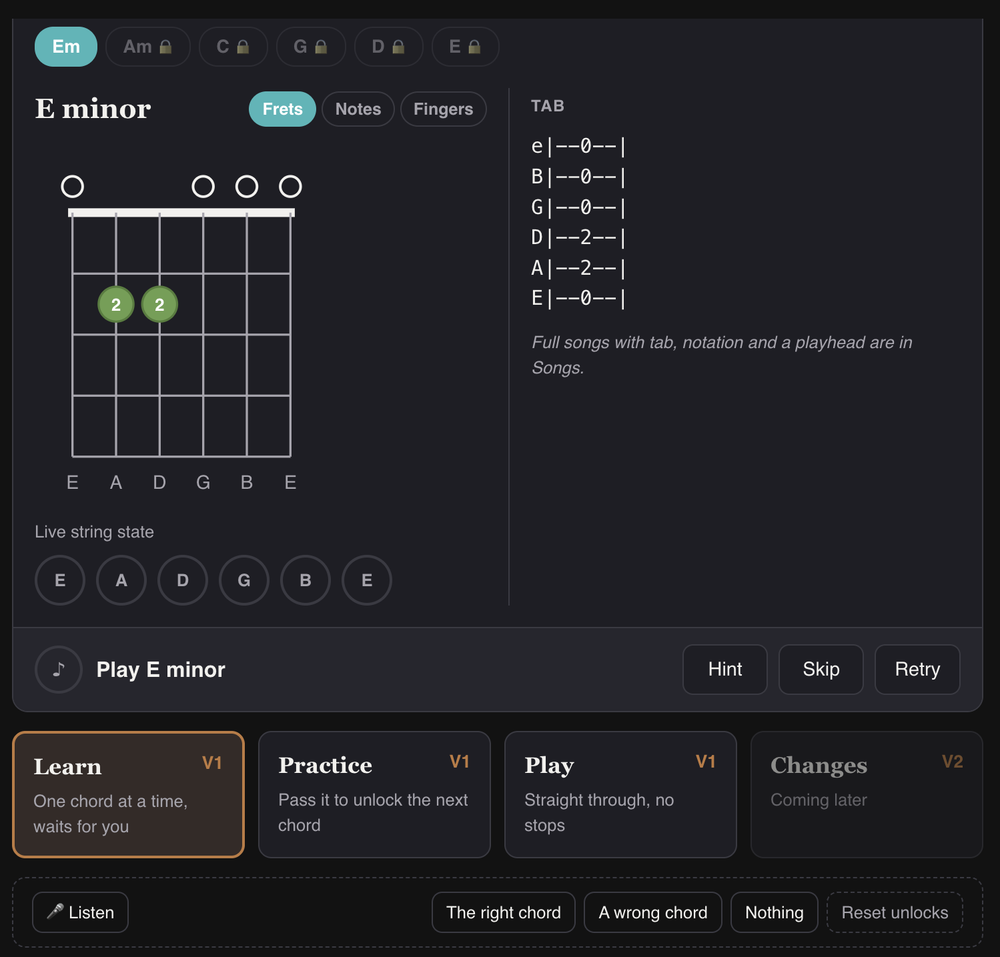

*Photo: Guitar lesson*

**At Milestone 3.** Guided lessons were shelved at M2. For guitar they came back as a **Learn** view:

- **Chord lessons** over 20 chords, in four modes: Guided, Practice, Play and one-minute Changes.
- **Strum on the beat**, moved here from Exercises.
- The microphone never changes the lesson's chord on its own. Wrong tries are counted, and the player moves on with a chord choice, Skip or Next.
- Chord diagrams draw barres and pulse in finger order.
- **Progress follows the account** (table `guitar_progress`). It is kept in the browser so lessons work signed out, and merged with the account's copy on sign-in: a pass beats a skip, and the higher best wins.

The vocal side has no lesson map. Its learning loop is practice sessions and attempt history (Section 2.4).

### 2.3 Live Practice Runs

Live practice runs are uninterrupted run throughs of a passage. Once a user starts singing or playing, a live-feedback session shows what the microphone is picking up against what the score expects, and both are updated continuously as the run through proceeds. For vocals, the detected and expected notes are displayed, and for guitar, the chord and the state of each string is visualized. For guitar, strings that are under-pressed or muted are also flagged whenever that data is available. If the user input is too quiet to make a reliable call, the app shows an explicit "couldn't hear you" state instead of logging the moment as a miss.

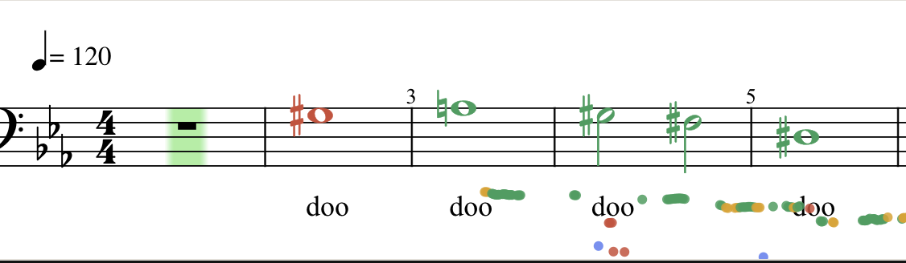

*Photo: pitch detection for song*

This design supports scalability because the live feedback mechanism isn't instrument-specific. Every detection analyzer (pitch for voice, chord-FFT for guitar) emits the same normalized event, so the UI simply renders the response it's given without further processing. Additional instruments can be added to the application with little to no modifications to this mechanism.

**How a live run works.** Everything during the run happens on the device: the microphone is read about 50 times a second, each reading is matched to the note the score expects at that moment, and the result is drawn on the staff as it happens. Only the finished try is saved.

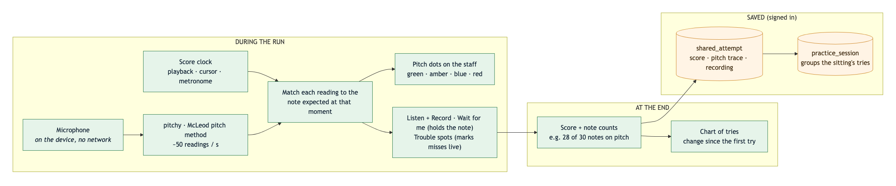

*Figure 2.3a. A live practice run. Green boxes run in the browser with no network; orange is what is saved for a signed-in user.*

**New practice controls since M2:**

- **Metronome and tempo.** Beat clicks with an accented downbeat, an optional one-bar count-in and a volume, shared by Vocal and Guitar. Tempo is 50–100% in 5% steps, remembered per song. Voice playback keeps score time, so a slowed attempt still scores against the written rhythm. The click is high-passed noise so the pitch tracker never mistakes it for a sung note.
- **Guitar "Wait for me".** A chord one note off (A7 for A) is not accepted and the extra note is named, and strings still ringing from the last chord are not counted as wrong. A Full / Easy option per song (Easy scores the first note of each bar and each chord change). A "Tune first?" banner returns when a song's notes sit out of tune.
- **Vocal "Wait for me" and "Trouble spots" are scored.** Wait for me times each note from when it is highlighted to when the singer first lands on it: full marks within 1 second, none from 6 seconds, and notes over 3 seconds are called out in amber. Trouble spots counts a note right when it is within 50 cents and steady for 60% of its length, half right a half step off (amber), and otherwise a miss (red). Every finished run is saved with its note counts (to the account when signed in, in the browser otherwise) and joins a chart of tries for that song, part, accompaniment and mode.

**Examples from the deployed app.** The screenshots below come from https://harmonic-vert.vercel.app, singing the built-in "Ode to Joy" (30 notes, 120 BPM) into a simulated microphone with a few deliberate mistakes.

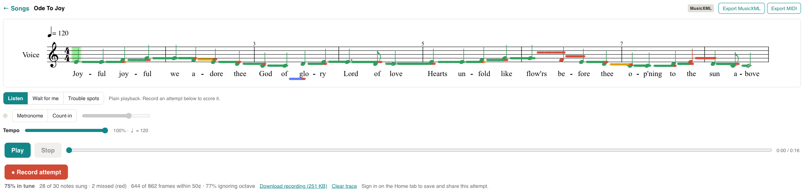

*Figure 2.3b. Listen + Record attempt. Each dot is one pitch reading: green in tune, amber close, blue the right note in the wrong octave (around "of glo-", sung an octave low), red a wrong note (around "flow'rs be-" and "the"). Notes are marked green when sung and red when missed: here 28 of 30, 75% in tune.*

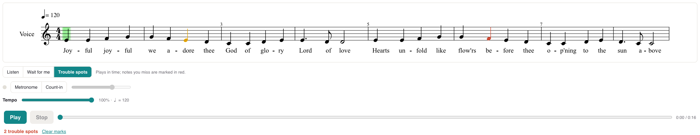

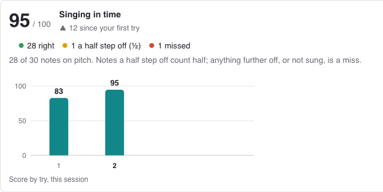

*Figure 2.3c. Trouble spots. Playback never waits; a note a half step off turns amber and counts half, a miss turns red. The summary counts each kind and charts every try: 83, then 95 on the second try.*

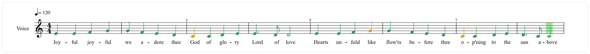

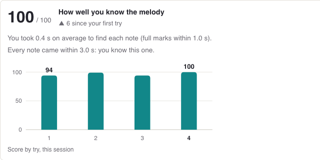

*Figure 2.3d. Wait for me. The cursor holds each note until it is sung in tune. The first try hesitated on three notes, marked amber (over 3 s to find); later tries found every note quickly, and the latest scored 100.*

### 2.4 Run-through Summaries and Attempt History

When a user finishes a live practice run, the scoring engine produces a summary of the attempt and analyzes it note by note, chord by chord. Pitches are labelled verified (green), wrong (red), or not-heard (gray), and rhythmic accuracy will be measured as early, on-time, or late. All this feedback is marked directly on the rendered notation, providing users with a clear roadmap of what went wrong and where.

Each attempt is added to the passage's history, and only the most recent score surfaces back on the lesson map. In this way, all attempts become part of a visible trend, facilitating progress tracking. To support this, attempt history and song storage features were designed to live in the backend, separate from the scoring engine and notation renderer capabilities of the frontend.

**At Milestone 3** this history is built. It is the largest change since M2:

- **Attempts are saved automatically** for a signed-in user, privately. "Copy link" shares one by link, and **Send to friends** puts it on their Home page.
- **Comments** on an attempt from its owner and the friends it was sent to.
- **Practice sessions.** Opening a song starts a session. Each recorded attempt appears under **This session** with its time, score, part, notes hit ("6 of 8 notes hit · 2 missed"), recording, a note to self that autosaves, and a 1–5 rating. Reopening the song within 30 minutes resumes the same session, **New session** starts a fresh one, and a session with no attempts is deleted. A **Practice sessions** view shows one card per song with a summary (times practised, attempts, best, last practised), **Practise** and **+ New session** buttons, and the sessions beneath it, each with its attempts and its scored Wait for me / Trouble spots runs.
- **Recording budget.** Recordings are the only thing that can fill the free storage tier, so they are opt-in per attempt ("Keep recording"), capped at 100 MB per user by a database trigger, shown as a storage-used bar, and deletable while keeping the attempt's score and notes.
- **Opened attempt history.** Opening an attempt (from Home or a link) shows, under its recording: your own note and rating on it (owner only), your friends' comments with a reply box, and **every try at the same song**, newest first, with its score, the change from the try before, the best one marked, its recording and comment count. Each try opens in place. A friend sees only the tries that were sent to them, never the owner's notes.
- **Clearer score line**: "80% in tune · of what you sang · 6 of 472 notes sung". The percent is over what was sung, the counts over the whole part.

### 2.5 Home and Social

- **Home**: Continue Practice (latest attempt with hit, close and missed counts, trouble spots and an accuracy ring), Working On (songs practised with best-score bars), Quick Practice, Recent Activity (Received and Sent attempts with comments), and **My Files**: song files opened on this device, kept in IndexedDB and never uploaded. Opening a friend's attempt finds the song in My Files automatically.
- **Social**: your **name#tag**, an invite link (opening it makes you friends), add a friend by name#tag, and Friends / Requests / Sent lists.

### 2.6 Vocal Arranger

Vocal → **Arrange a song for voices**. Harmonic listens to a song's lead vocal and chords and writes a new arrangement for voices, which opens as a normal multi-part score to hear, practise and export as MIDI or MusicXML.

- **Voicings:** Solo + TTBB (default), TTBB, SATB, and two parts (TB). In Solo + TTBB the soloist sings the tune with the words and the backing holds each chord as a plain block chord on "oo" while the solo sings and "ah" while it rests.
- **Two ways in:** an audio file the user owns, arranged entirely in the browser (no upload, about 70 MB of models downloaded once); or a **YouTube link**, arranged on the team's server for users on an allow-list, which also adds **lyrics** under the tune.
- **How it works:** vocal separation, Basic Pitch for the sung notes, beat tracking, and a chord pass that hears the chords again in the song's own scale and changes them only at bar lines or half-bars. The tune is cleaned of stray sixteenth notes, snapped to eighths and sung legato, then moved to a key that suits the singers. Lyrics come from published synced lyrics (LRCLIB) or Whisper, aligned line by line.

### 2.7 Guitar Tools

- **Exercises: ear training.** Three levels: chord type, which chord (weighted toward misses, with per-chord accuracy), and the chords of the last song opened. Chords play through a plucked-string synth.
- **Fretboard.** The whole neck to fret 20 with every note labelled, five tunings, tap a note to hear it and light up every place with the same pitch.
- **Audio to tab.** A first draft that turns an MP3 into tab. It is inaccurate and marked as experimental.

---

## 3. Core Audience

Harmonic aims to provide value to students unserved by existing instrument learning tools.

### 3.1 Independent Learners

This category includes self-directed learners with little prior musical experience and no access to an instructor. The concept-explanation and instrument-free drill stages of Harmonic's guided lessons instill fundamental theory and ear training from the very first lesson, and its sequential and prerequisite-gated structure provides students with a learning path that ensures skills build in order. Additionally, the soft gate feature advances students consistently to prevent them from getting stuck on one passage, disencouraging abandonment.

### 3.2 Stranded Intermediates

This category includes students who have mastered beginner technique and theory but lack a clear path toward further learning. Harmonic's live, automated feedback lets these musicians continue practicing without a fixed lesson plan by replacing the structured curriculum they've outgrown with real-time correction on whatever piece they choose to work on. Run-through summaries, updated notations, and saved score history empowers such students to identify areas of improvement, rework them, and track their progress over time.

### 3.3 Returning Musicians

This category includes lapsed players who retain some physical technique but have lost skills in fundamental theory and ear-training. The concept-explanation and instrument-free drill stages of Harmonic's guided lessons rebuild that foundation directly. Skip, tempo, and soft gated controls then let them move past material they are already familiar with, enabling such students to make the most of the limited time they have to practice each day.

### 3.4 Choir and A Cappella Singers (new at M3)

A secondary audience added at M3. The arranger gives them a part to practise for songs that have no published arrangement, and the per-song tries, best score and their own notes on each try give stranded intermediates and returning musicians the visible trend described in Section 2.4.

---

## 4. Software Stack

### 4.1 Frontend Framework

The client is a React app built with Vite. This structure was chosen for its fast iteration loop and wide tooling support. It's packaged as an installable progressive web application (PWA), which offers a strong foundation for fast deployment and doesn't require a new native build pipeline for every platform.

- App: React 19 + Vite, packaged as an installable PWA that works offline. Heavy parts (alphaTab, the PDF code) download only when first used.
- Notation: OpenSheetMusicDisplay for voice. Its cursor gives the timing and expected notes, so playback, cursor and scoring share one clock. alphaTab for guitar, the only web renderer that draws tabs.
- Playback: Tone.js for voice; alphaTab's own synth (alphaSynth) for guitar songs.
- Audio:
  - Voice: pitchy (McLeod pitch method) on the mic, about 50 times a second.
  - Guitar: a shared AudioWorklet capture that sees every sample and detects strums, feeding the tuner (pitchy) and chord verification. Chord verification compares each strum's energy per note name (C to B) against templates of the chords the app teaches.
- Arranger models (new at M3): TensorFlow.js and ONNX Runtime Web for vocal separation, Basic Pitch and beat tracking, loaded only when the arranger is used.
- IndexedDB for My Files: song files stay on the device.
- Live audio never leaves the device. Only finished attempts, scored runs and recordings the user chooses to keep are uploaded.

### 4.2 Backend Infrastructure

Supabase (managed) is still the only backend service. At M2 it was used for the first three of these; at M3 for all seven:

1. Sign-in: Google/GitHub OAuth, which issues the login token (JWT).
2. Public catalog: song rows plus MusicXML files, readable without an account.
3. Attempts: one table holding the pitch trace, score, part and song reference, plus an optional recording in a private bucket. Saved privately, shared by link or to friends, with comments.
4. Social: profiles with name#tag, friendships, invite codes.
5. Practice sessions, scored practice runs, owner feedback and the recording budget.
6. Guitar progress across devices.
7. Arrangement jobs: a queue table and a private `arrangements` bucket for the arranger worker's results.

The M2 progress tables (`run_through`, `recording`, `lesson_progress`, `song_pref`) are still unused: `shared_attempt` became the attempt history instead, because it already held everything a run needs.

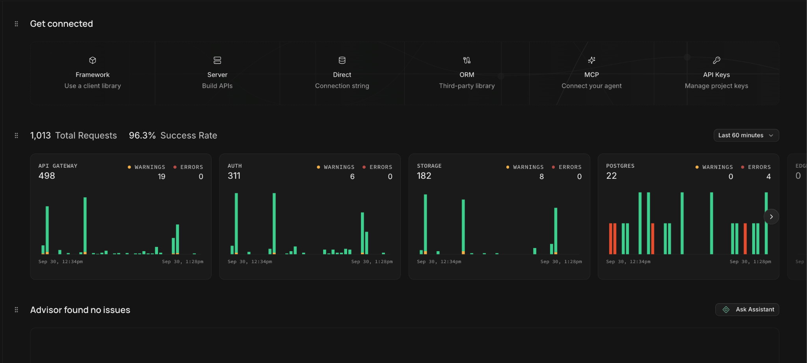

### 4.3.1 SCHEMA

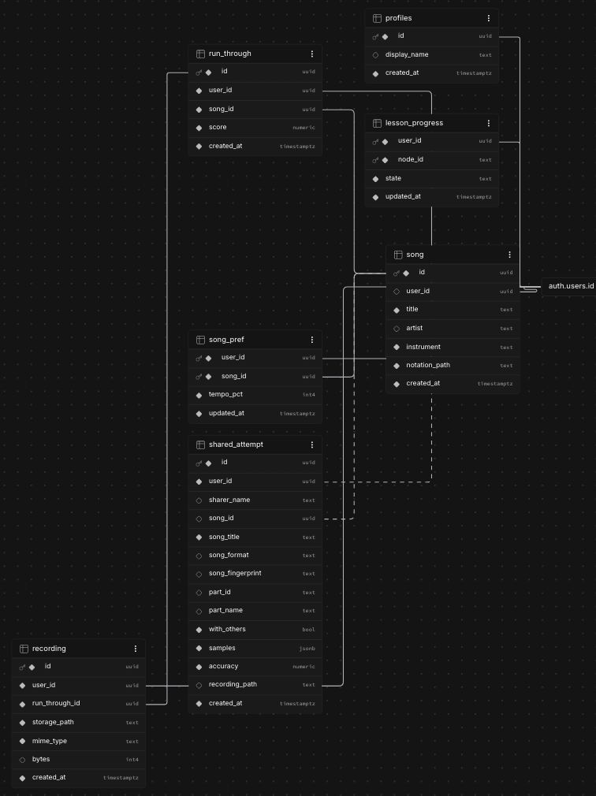

The app calls a small TypeScript layer in `src/lib` (not a server), which talks to Supabase over HTTPS with the user's JWT:

- `auth.ts`: OAuth sign-in, session, sign-out.
- `songs.ts`: catalog list and time-limited download links.
- `attempts.ts`: share, open by id, recording link, unshare; since M2 also save privately, send to friends, inbox, comments, the tries at a song (`listSongAttempts`), `canViewAttempt`.
- `friends.ts`: name#tag, find by handle, friend requests, invite links.
- `home.ts`: songs in progress and the latest attempt for Home.
- `practiceSessions.ts`: start, resume and end sessions, list them, save a note and rating, delete a recording, storage used.
- `practiceRuns.ts`: save and list scored Wait for me / Trouble spots runs.
- `arrangements.ts`: queue an arrangement from a link, poll it, download it.
- `progress.ts`: guitar progress load, merge and save.

**Tables added since M2 (migrations 0006–0015):**

| Migration | Adds | Access |
|---|---|---|
| 0006, 0007 | Guitar copy of Ode to Joy with string and fret on every note; guitar attempts in `shared_attempt` (instrument, per-note verdicts instead of a pitch trace) | as `shared_attempt` |
| 0008 `user_handles` | `profiles.display_name` + 4-digit tag (name#tag), invite codes, `find_user_by_handle()` | own row; lookup by exact handle |
| 0009 `friendships` | `friendship` (requested / accepted), request, accept, decline, unfriend, invites | the two people involved |
| 0010 `attempt_sharing` | `shared_attempt.link_shared` (private by default), `attempt_recipient`, `attempt_comment`, `can_view_attempt()` | owner and the friends it was sent to |
| 0011 `arrangement_jobs` | `arranger_access` allow-list, `arrangement_job` queue with limits, `claim_arrangement_job()`, private `arrangements` bucket | own jobs; the worker uses the service role |
| 0012 `solo_voicing` | the `solo_ttbb` voicing | — |
| 0013 `guitar_progress` | one row per user: chords cleared, changes bests, strum steps | owner only |
| 0014 `practice_sessions` | `practice_session`; on `shared_attempt`: `session_id`, `self_note`, `rating`, `recording_bytes`; recording budget trigger; `end_practice_session()`, `close_idle_practice_sessions()`, `recording_storage_used()` | owner only; `get_shared_attempt()` hides notes from others |
| 0015 `practice_runs` | `practice_run`: every scored Wait for me / Trouble spots run with its note counts and session | owner only |

### 4.3.2 Sharing an Attempt

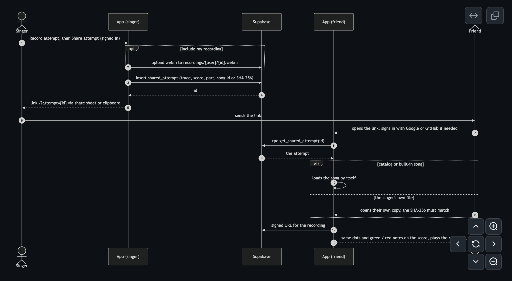

### 4.3.3 Vocal Architecture

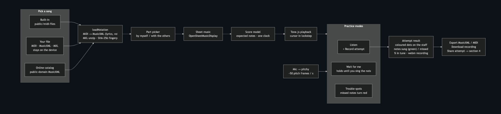

### 4.3.4 Guitar Tabs

### 4.3.5 System Overview

*System overview at Milestone 2.*

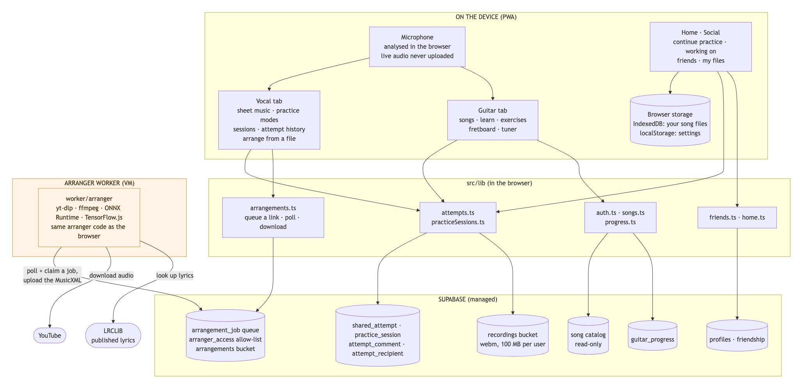

*System overview at Milestone 3. Everything in the top box runs on the user's device; `src/lib` is TypeScript in the browser, not a server; the orange box is the arranger worker, the only code that runs outside the browser.*

### 4.4 Main data flows:

- Open a song: built-in files come from the app itself, catalog songs through a time-limited link. Either way the file becomes MusicXML in memory and goes to the renderer.
- Share an attempt: the trace and score are saved as one row, plus the optional webm recording, and a link `/?attempt=<id>` is returned.
- Open a share: the row is fetched through a function that returns exactly one attempt, the recipient's copy of the song is matched, and the attempt is redrawn.
- Finish an attempt (signed in, new at M3): the score, pitch trace, per-note verdicts and part are saved as a private `shared_attempt` row in the current practice session. If "Keep recording" is on and the user is under budget, the webm goes to the private `recordings` bucket and its size counts against the 100 MB cap.
- Finish a Wait for me / Trouble spots run (new at M3): one `practice_run` row with the score and note counts.
- Send to friends (new at M3): `attempt_recipient` rows are added; the attempt and its recording become readable to those friends, and it appears on their Home.
- Open an attempt (new at M3): also shows the owner's notes (owner only), comments, and the tries at that song the viewer is allowed to see.
- Arrange from a link (new at M3): the app inserts an `arrangement_job`; the worker claims it, downloads the audio, runs the models, writes the MusicXML to the `arrangements` bucket and marks the job done; the app downloads and opens it.

### 4.5 Functions and our database functions

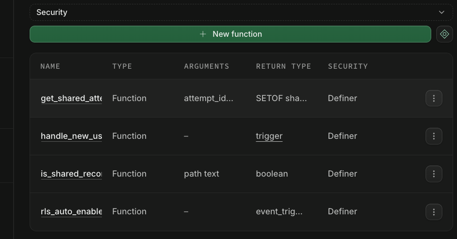

### 4.6 Arranger Worker (new at M3)

The only code that runs outside the browser. A Node process in `worker/arranger/` on a team VM (Proxmox, 16 vCPU, 15 GB RAM) polls `arrangement_job`, uses yt-dlp and ffmpeg to get the audio, runs the same arranger code as the browser (`app/src/tabs/vocal/arrange/`) plus Whisper for lyrics, and writes the result back to Supabase. A 4-minute song takes about five and a half minutes on CPU.

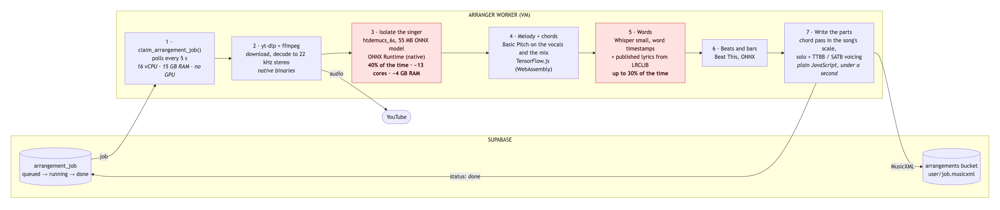

*Figure 4.6. One arrangement on the worker. Red stages are where the time goes: isolating the singer (40%, about 13 cores and 4 GB of memory) and finding the words (up to 30%). Measured on a 4-minute song: 332 s in all.*

**Why a VM and not Supabase or Vercel.** Supabase Edge Functions allow 2 seconds of CPU per request, 256 MB of memory and no native binaries, while one arrangement is minutes of model inference using ffmpeg and ONNX Runtime and about 4 GB of memory. Vercel's functions cap memory at 2 GB, run time at 300 s and bundle size at 250 MB, against about 540 MB of models and binaries; and YouTube blocks downloads from cloud data-centre addresses. Any host that can run a Node process (a VM, Fly.io, a GPU job service) can run the same worker unchanged, because it talks to Supabase only over HTTPS. The full measurements are in [docs/architecture.md, Section 5](../docs/architecture.md#5-arranging-a-song-from-a-link-the-one-job-on-our-own-machine).

---

## 5. Architecture Rationale

Four decisions shaped the majority of the codebase's design and implementation.

### 5.1 Scalability

Every audio analyzer emits an identical, normalized event, timestamped by the same transport clock that also drives playback, the cursor, and the countdown. The scoring engine captures these events without any visibility into which analyzer produced them, which keeps the scoring logic lean and ensures every event remains consistent on a single shared timeline. As a result, support for another instrument can be added with little to no modification to this mechanism. Practice sessions and attempt history are instrument-agnostic too: guitar attempts use the same tables, though Guitar does not show sessions yet.

**Where the work runs decides how Harmonic scales.** The expensive part of a practice run, listening to the microphone and scoring it, runs on each user's own device, so it grows with users at no cost to us. The server side sees one small row per finished try, plus a recording only when the user keeps it. The arranger is the one heavy server job. Its queue is claimed with `FOR UPDATE SKIP LOCKED`, so more workers can be added on any host without code changes, and each job goes to exactly one of them.

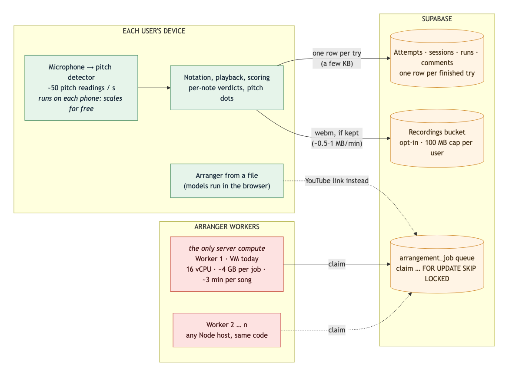

*Figure 5.1a. Green scales for free with users; orange is budgeted (rows are tiny, recordings are opt-in and capped at 100 MB per user); red is the only server compute, and it scales by adding workers.*

**The ladder.** The [scaling plan](../docs/scaling-plan.md) sets the triggers for each step up. Every step before the last is configuration, or a change to one module, because the client talks to the backend only through `src/lib`.

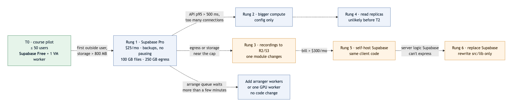

*Figure 5.1b. Today Harmonic is at T0: Supabase Free plus one VM worker. Blue rungs need no code change; orange rungs change one module (rung 3), nothing in the client (rung 5), or only `src/lib` (rung 6).*

### 5.2 Real-Time Responsiveness

The microphone feeds an AudioWorklet that produces raw PCM, and every stage of analysis runs entirely client-side. Only scores, progress data, and a compressed recording (optional) are ever sent to Supabase. This design eliminates network latency as a concern, enabling real-time feedback during guided lessons and live practice runs. Beyond maximizing the user experience with a native-app feel as a PWA, this design also keeps the backend minimal, with no real-time processing burden of its own. The arranger is not real-time, so it is the one place work runs on a server.

### 5.3 Standardization

Because licensing restrictions prevent the app from hosting copyrighted music on its own servers, any file a user uploads must instead be processed and stored locally on their device. This requires the app to accept music files in any common format. To keep the experience consistent across formats and features, every uploaded file is converted to and stored as MusicXML regardless of its original format. This standardization allows a single stored file to serve multiple renderers across instruments, and establishes that file as the sole source of truth, from which playback timing is derived directly from the rendered score itself. The arranger's output is MusicXML too, so arranged songs flow into the existing renderer, playback, parts and scoring with no special cases.

### 5.4 Code Leanness

The application requires no custom server, no dedicated runtime environment, and no additional custom APIs. Although it is front-end heavy, computation occurs primarily on the client side, with the Supabase backend being pre-built and requiring configuration only. Authorization is handled at the database level, and every table is governed by row-level security policies scoped to the authenticated user. The only exception is the public song catalog, which any user can read from but none can write to. A request without a valid JWT for the correct owner is rejected directly by Postgres. As a result, access control lives in the database and doesn't require more application code. Combined with standardized music files and a scalable scoring engine, this keeps the system's operating overhead minimal.

At M3 there is still no custom API server. Every new table is row-level secured, and friends' access to attempts goes through `can_view_attempt()` and security-definer functions. The one addition is the arranger worker (Section 4.6), which holds no state of its own: the queue, the allow-list and the results all live in Supabase.

### 5.5 Storage Budget (new at M3)

Supabase's free tier allows 1 GB of file storage, 5 GB of egress a month and 50 MB per file. Scores, traces, notes and runs are small and always kept. Audio is the only large data, so it is opt-in, capped at 100 MB per user and deletable.

---

## 6. Known Gaps and Next Steps

- **Private notes and a raw query.** A friend an attempt was sent to could read the owner's `self_note` and `rating` with a hand-built database query, because the recipient policy covers whole rows. The app and RPC never show them. Fix: move owner feedback to an owner-only table.
- **Record from an opened attempt.** Opening your own attempt shows its history but not the Record button; practising is still done from the song page.
- **Home "Working On" card** should open the song's full history directly.
- **Guitar sessions:** the session code is instrument-agnostic but not wired into Guitar yet.
- **Arranger accuracy:** chord recognition on dense rock mixes still confuses relative major and minor chords; the browser path has no lyrics yet.
- **Audio to tab** is an early draft.
- **Confirm email** is off in Supabase auth and must be turned on, with custom SMTP, before real users.

---
